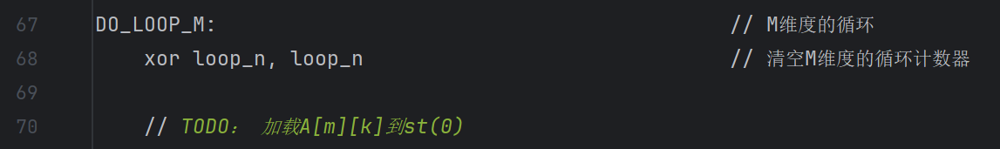
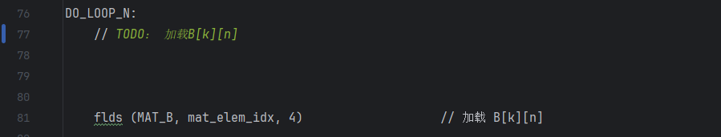
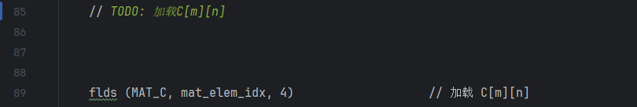

# 练习2：实现矩阵乘法

- **任务**：使用提供的汇编代码实现矩阵乘法，并调整代码以处理不同大小的矩阵。
- **目标**：

  - 理解寄存器间接寻址和基址+变址寻址方式；
  - 初始化矩阵数据，并在汇编中使用指针。

#### 1. 为`src/lab1/gemm_kernel.S`中的`GEMM_INIT`过程（第56行）添加合适的矩阵B地址保存指令


#### 2. 为`src/lab1/gemm_kernel.S`中的`DO_GEMM`过程（第70行）添加加载`A[m][k]`到FPU寄存器栈的逻辑



#### 3. 为`src/lab1/gemm_kernel.S`中的`DO_GEMM`过程（第77行）添加加载`B[k][n]`到FPU寄存器栈的逻辑



#### 4. 为`src/lab1/gemm_kernel.S`中的`DO_GEMM`过程（第85行）添加加载`C[m][n]`到FPU寄存器栈的逻辑



#### 5. 验证矩阵乘法内核的正确性

  编译和测试之前，请先在终端通过`cd`命令进入`lab1/build`目录。

  执行命令编译测试程序：

```bash
cmake -B . -S ../ && cmake --build ./ --target lab1_test_gemm_kernel.unittest
```

  运行测试：

```bash
./dist/bins/lab1_test_gemm_kernel.unittest --gtest_filter=gemm_kernel.test0
```


#### 6. 编译上层代码形成二进制程序

  编译和测试之前，请先在终端通过`cd`命令进入`lab1/build`目录。

  执行命令编译测试程序：

```bash
cmake -B . -S ../ && cmake --build ./ --target lab1_gemm
```

#### 7. 运行代码得到输出

```bash
./dist/bins/lab1_gemm 256 256 256
```


