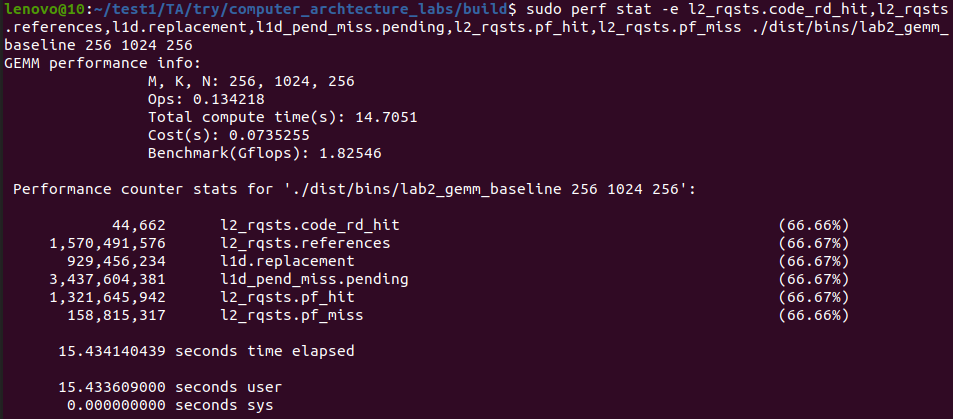

# 练习1：利用性能分析工具分析性能瓶颈

- **任务**：从访存层面分析示例代码的性能瓶颈。
- **目标**：学会利用perf性能分析工具分析示例程序的缓存命中率。
- **示例代码**：`lab2_gemm_baseline.S`

#### 0. 下载并解压实验包

  从[首页链接](../../#1)下载`lab2.tar.gz`，将其拷贝至用户目录，并执行命令`tar -zxvf lab2.tar.gz`解压实验包，然后执行`cd lab2`进入项目根目录。

#### 1. 编译生成待分析的二进制程序`lab2_gemm_baseline`

  在`lab2`目录下执行下列命令创建`build`目录：

```bash
mkdir -p build && cd build
```

  执行命令编译测试程序：

```bash
cmake -B . -S ../ && cmake --build ./ --target lab2_gemm_baseline
```

#### 2. 使用`perf stat`命令结合`-e`参数指定事件查看程序的性能事件并根据结果分析定位性能瓶颈点(指定的事件应随分析而变)

```bash
sudo perf stat -e L1-dcache-loads,L1-dcache-load-misses ./dist/bins/lab2_gemm_baseline 256 1024 256
```

> [!NOTE] **事件说明**
>
> `L1-dache-loads`：从L1 DCache读取数据的指令数量  
>   `L1-dcache-load-misses`：在L1 DCache中读取数据时发生缺失的次数

  由于perf版本原因，实际支持的事件可能有差异，可在`perf list`得到的事件表中自行选取需要的事件。


