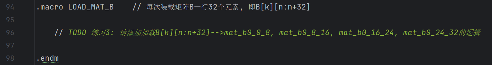
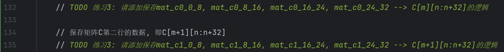

# 练习2：基于AVX指令设计并实现高性能矩阵乘法计算内核

- **任务**：利用AVX指令实现性能更好的矩阵乘法计算内核。
- **子任务**：

  - 计算内核  矩阵（）的元素个数不少于64，即 ；
  - 计算内核各维度必须满足如下要求: ，，；
  - 计算内核采用流水线设计读取、计算、写回等过程。
- **目标**：学会利用向量指令实现计算性能更高的矩阵乘法计算单元。

#### 0. 模板代码`src/lab3/gemm_kernel_opt_avx.S`的实现思路

  模板代码`src/lab3/gemm_kernel_opt_avx.S`采用如下图所示的矩阵分块算法：


  最内层循环每次使用  的`A[m:m+2][k]`分块和  的`B[k][n:n+32]`分块计算出  的`C[m:m+2][n:n+32]`分块。最内层的分块矩阵乘法采用 AVX 向量指令实现并行计算。

#### 1. 为`src/lab3/gemm_kernel_opt_avx.S`的`LOAD_MAT_C`过程（第110行、第117行）添加加载`C[m:m+2][n:n+32]`到AVX寄存器的逻辑


#### 2. 为`src/lab3/gemm_kernel_opt_avx.S`的`LOAD_MAT_A`过程（第90行）添加加载`A[m+1][k]`到AVX寄存器的逻辑


#### 3. 为`src/lab3/gemm_kernel_opt_avx.S`的`LOAD_MAT_B`过程（第96行）添加加载`B[k][n:n+32]`到AVX寄存器的逻辑



#### 4. 为`src/lab3/gemm_kernel_opt_avx.S`的`DO_COMPUTE`过程（第141行）添加计算`C[m:m+2][n:n+32]+=A[m:m+2][k]*B[k:k+8][n:n+32]`的逻辑


#### 5. 为`src/lab3/gemm_kernel_opt_avx.S`的`STORE_MAT_C`过程（第132行、第135行）添加保存`C[m][n:n+32]`和`C[m+1][n:n+32]`的逻辑



#### 6. 验证新内核的正确性

```
# build目录下执行
cmake -B . -S ../ && cmake --build ./ --target lab3_gemm_opt_avx.unittest
./dist/bins/lab3_gemm_opt_avx.unittest
```


#### 7. 对比优化后的算法与基线的性能（测试用例根据自己的优化选择），根据算法和结果分析优化方案的优缺点。

```
# build目录下执行
cmake -B . -S ../ && cmake --build ./ --target lab3_gemm_opt_avx
./dist/bins/lab3_gemm_opt_avx 256 256 256
```


#### 8. 测试并对比新内核在不同数据规模下的性能差异

  改变输入矩阵的数据规模（比如边长为32、64、128等），测试AVX矩阵乘法内核的性能数据，绘制性能变化曲线图并进行合理分析。
