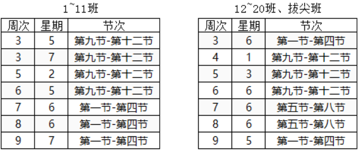

# 课程概况

  本实验文档为哈尔滨工业大学（深圳）《计算机体系结构》课程实验指导材料。页面顶端为各个实验项目的指导书；页面左侧为指导书的各个小节目录，右侧为小节内的索引，页面右上角可详细搜索，页面下方可切换上下小节。请务必按顺序阅读指导书，有问题积极在群内提出。

> [!WARNING] **声明**
>
> 本课程资料仅限哈尔滨工业大学（深圳）《计算机体系结构（实验）》2026秋季课程使用，严禁扩散或用作其他用途。

## 内容安排

  本课程实验旨在使同学们掌握计算机体系结构中 **Cache优化**、**指令级优化** 和 **并行优化**。内容包括以下几个方面：

- 编写基础实验框架：包括使用汇编代码编写矩阵乘法和Llama推理框架以及Llama推理框架中矩阵乘法（或矩阵向量乘法）在推理时间的占比。
- 编写Cache优化汇编程序，首先理解处理器架构的Cache层次以及大小。其次理解矩阵乘法中数据读写对Cache的使用情况。最后根据数据与Cache特点，优化矩阵数据的读写模式，提高Cache利用率，提升矩阵乘法性能。
- 编写指令级并行CPU程序，理解指令级并行对矩阵乘法的加速。
- CUDA编程，包括基本的GPU矩阵乘法程序和共享内存的优化。
- Llama.c程序加速（开放实验）。

  以上内容将编排为6个实验：

| 专题 | 实验 | 学时 |
| --- | --- | --- |
| CPU优化专题 | 实验1：编写矩阵乘法 | 4 |
| 实验2：使用Cache优化矩阵乘法 | 4 |
| 实验3：使用指令级并行、向量指令和并行优化矩阵乘法 | 8 |
| 撰写实验报告 | - |
| GPU优化专题 | 实验4：使用C/CUDA编写GPU代码 | 4 |
| 实验5：使用共享内存优化GPU代码 | 4 |
| 撰写实验报告 | - |
| Llama测试 | 实验6：Llama模型推理性能评测 | 4 |
| 撰写实验报告 | - |

## 课表安排

  本学期实验分2个班上课，**上课地点均为T2507**，各班课表如下表所示。少数同学某一周的课表若存在课程或考试等冲突情况，可根据下表自行选择到其他班上课。

## 其他

- 实验包下载：[校园网下载链接](http://10.249.14.10:3011/)
- 作业提交方式：提交作业的方法和流程见页面左侧《作业提交说明》。
