# 计算机体系结构实验 - 实验1指导书汇总

> 本文档为实验1所有章节的 1:1 完整汇总转译版，供离线阅读与后续 Agent 查阅。

## 目录导航

- [实验1：编写矩阵乘法](./00_实验概述.md)
- [实验原理](./01_实验原理.md)
- [练习1：环境搭建与初步测试](./02_练习1.md)
- [练习2：实现矩阵乘法](./03_练习2.md)
- [练习3：获取目标处理器的缓存信息](./04_练习3.md)
- [练习4：学习性能分析工具Perf的基本使用](./05_练习4.md)
- [预习下一个实验](./06_预习下一个实验.md)

---

<!-- Section: 00_实验概述.md -->
# 实验1：编写矩阵乘法

## 实验目的

  1. 理解计算机指令集架构、地址模式；

  2. 通过实现矩阵乘法程序学习并应用 x86-64 汇编语言中的不同寻址方式；

  3. 理解在硬件层面如何访问和操作内存。

## 实验前准备

  复习汇编语言的基本概念，重点了解如寄存器间接寻址、基址+变址寻址、立即数寻址和比例变址寻址等寻址方式。

  实验环境：安装了汇编器和调试器的计算机。

## 实验内容

  1. 编写简易汇编程序，熟悉和验证汇编实验环境；

  2. 使用提供的汇编代码实现矩阵乘法，并调整代码以处理不同大小的矩阵；

  3. 通过操作系统命令、文件和评估工具获取系统目标处理器的缓存信息；

  4. 学习使用perf观察程序性能。


---

<!-- Section: 01_实验原理.md -->
# 实验原理

## 1. 矩阵乘法的遍历方式

  假设矩阵  大小为 ，矩阵  大小为 。根据《线性代数》的定义，矩阵  和矩阵  的相乘的结果为  大小的矩阵  ，矩阵  的元素可由下述公式计算：

  假设矩阵 、矩阵  和矩阵  可按《线性代数》中分块矩阵乘法的定义划分成如图2-1所示的子矩阵。由分块矩阵乘法的定义可知 。要完成  的计算必须沿  维度完成矩阵  和矩阵  所有分块的点乘的计算。

  一般情况下，通常会先遍历结果矩阵的两个维度，最后再遍历剩下的一个维度。如上面介绍的矩阵  元素的计算公式就是典型的  遍历方式。这种遍历方式的优点在于最后一个维度遍历完即可完成矩阵  的一个元素的计算。

  除了  遍历方式外， 遍历方式（也称秩  更新）的使用也较为普遍。不同于  遍历方式，使用  遍历方式计算矩阵  时需要存中间结果。由图2-1可知，遍历矩阵  的一列和矩阵  的一行，只能得到矩阵  每个元素的一部分结果，只有当矩阵  和矩阵  的所有分块全遍历完时才能得到矩阵  的最终结果。相较于  遍历方式， 遍历方式能较好的保证空间访问的局部性，提高缓存的利用率。

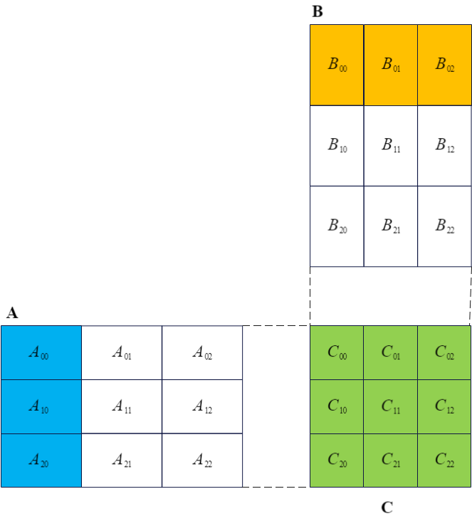
图2-1  遍历的矩阵乘法算法

## 2. x86-64简述

  x86-64是x86的64位扩展，其在保持良好兼容性的基础上将寄存器和虚拟地址空间扩展到64位，并提升了指令集的功能和性能。

### 2.1 寄存器概述

  x86-64架构包含状态和控制寄存器、程序指针寄存器、通用寄存器、向量寄存器等多种类型的寄存器，如表2-1所示。

表2-1 x86-64架构的部分寄存器

| 类型 | 名称 | 位宽 | 说明 |
| --- | --- | --- | --- |
| 控制和状态 寄存器 | RFLAGS | 64 | 处理器标志位信息，包括零标志（ZF）、符号位（SF）、进位位（CF）、溢出位（OF）、中断使能位（IF）等 |
| 指针寄存器 | RIP | 64 | 当前指令的地址 |
| 通用寄存器 | RAX | 64 | 常用作累加、存放**乘积或被除数的低64位**、存放**除法的商**，或传递**子程序的返回值** |
| RBX | 64 | 常用作基数寄存器 |
| RCX | 64 | 常用作计数器，或传递**子程序调用时的第4个参数** |
| RDX | 64 | 常用作数据寄存器、存放**乘积或被除数的高64位**、存放**除法的余数**，或传递**子程序调用时的第3个参数** |
| RSI | 64 | 常用作字符串操作的源索引（Source Index）寄存器，或传递**子程序调用时的第2个参数** |
| RDI | 64 | 常用作字符串操作的目标索引（Destination Index）寄存器，或传递**子程序调用时的第1个参数** |
| RSP | 64 | 栈指针 |
| RBP | 64 | 栈基址指针 |
| R8~R15 | 64 | 通用；R8、R9分别用作传递**子程序调用时的第5、6个参数** |
| 向量寄存器 | XMM0~XMM15 | 128 | SSE (Streaming SIMD Extension) 寄存器；YMM的低128位 |
| YMM0~YMM15 | 256 | [AVX (Advanced Vector eXtension)](https://www.intel.com/content/www/us/en/developer/technical-library/overview.html?f:@stm_10309_en=%5BIntel%C2%AE%20Technologies%3BIntel%C2%AE%20Data%20Center%20Technologies%3BIntel%C2%AE%20Advanced%20Vector%20Extensions%20(Intel%C2%AE%20AVX)%5D) 寄存器 |

### 2.2 寻址方式

  x86-64架构的常用寻址方式包括立即数寻址、寄存器寻址、直接寻址、寄存器间接寻址、基址变址寻址和比例变址寻址，如表2-2所示。

表2-2 x86-64架构的寻址方式

| 寻址方式 | 使用方法 | 说明 |
| --- | --- | --- |
| 立即数寻址 | `mov $0x1234, %rax` | RAX  `0x1234` |
| 寄存器寻址 | `mov %r8, %rax` | RAX  R8 |
| 直接寻址 | `mov 0x1234, %rax` | RAX  MEM[`0x1234`] |
| 寄存器间接寻址 | `mov (%rsp), %rax` | RAX  MEM[ RSP ] |
| 基址变址寻址 | `mov -20(%rsp), %rax` | RAX  MEM[ RSP - 20 ] |
| 比例变址寻址 | `mov -20(%rsp, %rcx, 4), %rax` | RAX  MEM[ RSP - 20 + RCX\*4 ] |

  由表2-2可知，直接寻址、寄存器间接寻址和基址变址寻址均可视为比例变址寻址的特殊情况。

### 2.3 常用指令

## 3. x87 FPU

### 3.1 寄存器概述

  x87 FPU浮点运算单元包含8个80位的通用寄存器 `R0` ~ `R7`、3个16位的状态和控制寄存器、2个48位的指针寄存器以及1个11位的操作码寄存器，如图2-2所示。

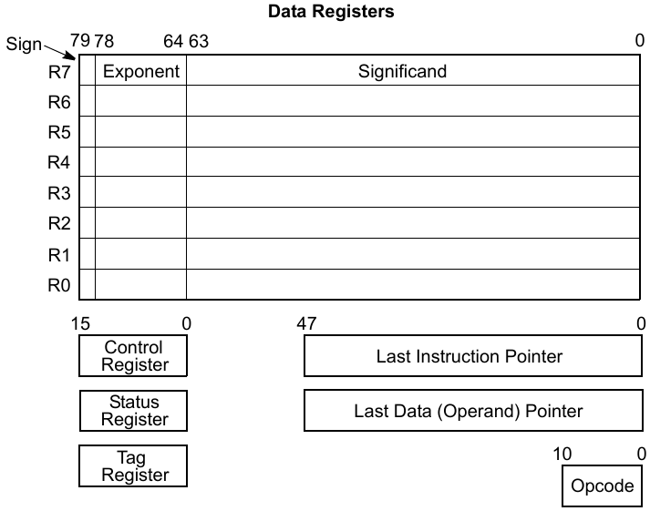
图2-2 x87 FPU的寄存器

  其中，通用寄存器用于存储计算数据。数据被写入通用寄存器时将被FPU自动扩展至80位的双扩展精度浮点数（Double Extended-Precision Floating-Point）；而当通用寄存器中的数据被写入内存时，可以在不同精度的浮点数、整数或BCD码的多种格式当中灵活选择一种进行写入。

  x87 FPU指令支持以栈的形式访问8个通用寄存器，且处于栈顶的数据始终被标记为 `st(0)`，如图2-3中的 (a) ~ (d)；同时也支持通过相对 `st(0)` 的偏移量来访问任意一个通用寄存器，如图2-3中的 (e)。

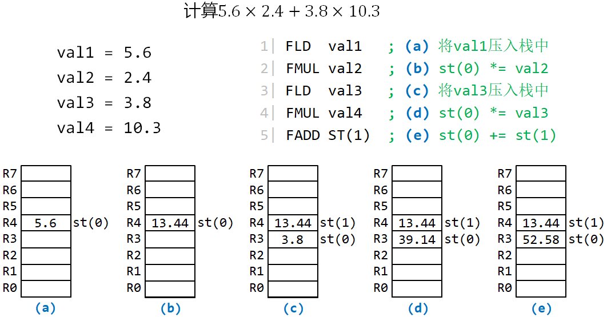
图2-3 通用寄存器访问示意图

### 3.2 常用指令

  x87 FPU支持加载指令、存储指令和运算指令。加载指令将数据压入通用寄存器栈。存储指令将栈中数据弹出并存储到主存单元。运算指令实现浮点数据的加减乘除和求相反数等操作。

  x87 FPU指令的命令规则是前缀 `f` + 前缀 `i` (可选) + 操作 + 后缀 `p`/`s`/`l`/`t`(可选) 。其中，前缀 `i`、后缀 `s`/`l`/`t` 分别表示指令的操作数是整数、单精度浮点数、双精度浮点数和双扩展精度浮点数；后缀 `p` 表示执行该指令时需要在运算完成后从通用寄存器栈中弹出一个数据。

> [!NOTE] **x87指令示例**
>
> * 例1：`fistpl (%rax)` 表示将 `st(0)` 中的双精度浮点数转换成整数后存储到 `%rax` 寄存器指向的存储单元，并从FPU栈中弹出一个数据。
> * 例2：`faddp %st(3), %st(0)` 表示将 `st(3) + st(0)` 的计算结果保存在 `st(3)`，然后把 `st(0)` 弹栈。


---

<!-- Section: 02_练习1.md -->
# 练习1：环境搭建与初步测试

- **任务**：编写一个简单的程序打印一个整数，以验证汇编环境。
- **目标**：

  - 确保正确安装和配置工具库；
  - 熟悉汇编语言的语法和编译过程。

> [!WARNING] **实验环境说明**
>
> 本课程实验需要在实验室的 **Ubuntu双系统** 上完成，不要使用虚拟机、WSL等。
>
>   开机时，请选择Ubuntu系统，而不是默认的Windows系统。

#### 0. 下载并解压实验包

  从[首页链接](../00_课程总览/00_课程概况.md)下载`lab1.tar.gz`，将其拷贝至用户目录，并执行命令`tar -zxvf lab1.tar.gz`解压实验包。

#### 1. 安装编译所需的基础环境

  首先执行下列命令更新软件源：

```bash
sudo apt update
```

  执行下列命令安装环境：

```bash
sudo apt install -y build-essential net-tools git vim cmake gdb make gfortran libnuma-dev libtirpc-dev
```

#### 2. 测试环境安装是否成功

  执行下列命令并查看是否能输出每个工具的版本信息。

```bash
cmake -version
gcc --version
gdb --version
```

#### 3. 为`src/lab1/print_integer.S`源码中的`convert_loop`循环(源码第33行)添加正确的结束指令


#### 4. 修复`src/lab1/print_integer.S`源码中的`print_string`过程中(第48行-第55行)存在错误

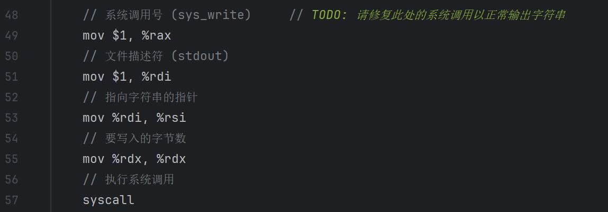

#### 5. 进入项目根目录，编译代码

```bash
cd lab1
mkdir -p build && cd build
cmake -B . -S ../ && cmake --build ./ --target lab1_print_integer
```

  以上第3条命令需从校内网克隆git仓库，因此请确保计算机能正常访问校园网。

#### 6. 运行代码得到正确输出

```bash
./dist/bins/lab1_print_integer
```

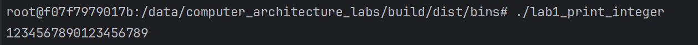


---

<!-- Section: 03_练习2.md -->
# 练习2：实现矩阵乘法

- **任务**：使用提供的汇编代码实现矩阵乘法，并调整代码以处理不同大小的矩阵。
- **目标**：

  - 理解寄存器间接寻址和基址+变址寻址方式；
  - 初始化矩阵数据，并在汇编中使用指针。

#### 1. 为`src/lab1/gemm_kernel.S`中的`GEMM_INIT`过程（第56行）添加合适的矩阵B地址保存指令


#### 2. 为`src/lab1/gemm_kernel.S`中的`DO_GEMM`过程（第70行）添加加载`A[m][k]`到FPU寄存器栈的逻辑


#### 3. 为`src/lab1/gemm_kernel.S`中的`DO_GEMM`过程（第77行）添加加载`B[k][n]`到FPU寄存器栈的逻辑


#### 4. 为`src/lab1/gemm_kernel.S`中的`DO_GEMM`过程（第85行）添加加载`C[m][n]`到FPU寄存器栈的逻辑


#### 5. 验证矩阵乘法内核的正确性

  编译和测试之前，请先在终端通过`cd`命令进入`lab1/build`目录。

  执行命令编译测试程序：

```bash
cmake -B . -S ../ && cmake --build ./ --target lab1_test_gemm_kernel.unittest
```

  运行测试：

```bash
./dist/bins/lab1_test_gemm_kernel.unittest --gtest_filter=gemm_kernel.test0
```

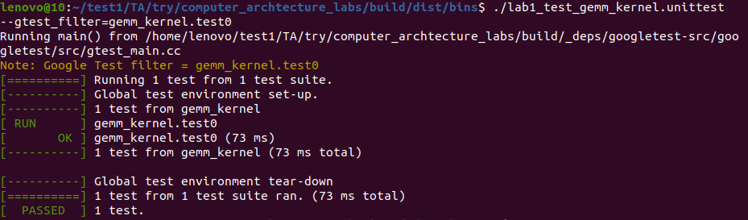

#### 6. 编译上层代码形成二进制程序

  编译和测试之前，请先在终端通过`cd`命令进入`lab1/build`目录。

  执行命令编译测试程序：

```bash
cmake -B . -S ../ && cmake --build ./ --target lab1_gemm
```

#### 7. 运行代码得到输出

```bash
./dist/bins/lab1_gemm 256 256 256
```

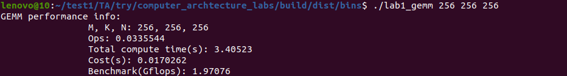


---

<!-- Section: 04_练习3.md -->
# 练习3：获取目标处理器的缓存信息

- **任务**：通过操作系统提供的命令、文件和评估工具获取系统目标处理器的缓存信息。
- **子任务**：

  - 获取目标处理器缓存层级和各级缓存大小信息；
  - 获取目标处理器各级缓存的组相联数、缓存行大小信息。
- **目标**：学会获取未知架构的处理器的缓存信息。

#### 1. 通过`lscpu`命令查看处理器型号、缓存层级信息

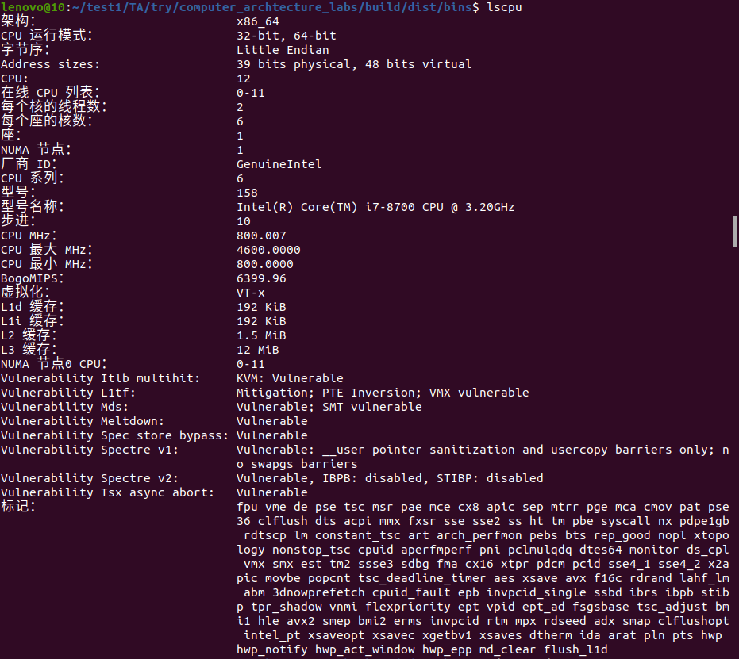

#### 2. 查看cpu0的L1D缓存的组数、组相联数和缓存行大小

```bash
cd /sys/devices/system/cpu/cpu0/cache
cd index0
# 查看缓存行大小
cat coherency_line_size
# 查看组数
cat number_of_sets
# 查看way数
cat ways_of_associativity
```

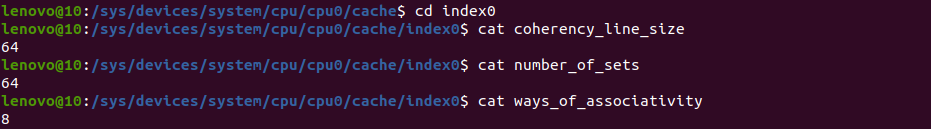

#### 3. 使用相同的方法查看L2, L3缓存的组数、组相联数和缓存行大小


---

<!-- Section: 05_练习4.md -->
# 练习4：学习性能分析工具Perf的基本使用

- **任务**：通过`perf`观察程序性能。
- **子任务**：

  - 通过`perf list`命令查看支持的性能事件；
  - 通过`perf stat`查看练习2的矩阵乘法程序的缓存使用情况。
- **目标**：学会`perf`的基本使用。

#### 1. 命令安装`perf`

`perf`工具包含在`linux-tools`中，安装时需保证其版本号与Linux内核版本号一致。

  以实验室的Ubuntu双系统为例，安装前执行`uname -r`查看内核版本号，再通过`apt`命令安装，如下图所示。

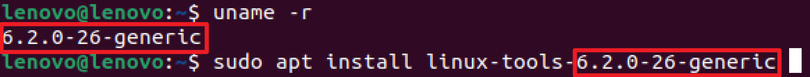

  实验室Ubuntu双系统的root密码是`user1234`。

> [!WARNING] **上图仅为示例，需以命令执行的实际输出为准**
>
> 使用`apt`安装`perf`时，“`linux-tools-`”后面的版本号信息需以`uname -r`的输出为准，请自行作相应的修改。

  若提示“`E: Unable to locate package linux-tools-xxx`”，可尝试安装邻近的版本或自行搜索其他解决方案。

#### 2. 查看`perf`支持的性能事件

```bash
sudo perf list
```

  若执行失败，可尝试执行`perf list`。

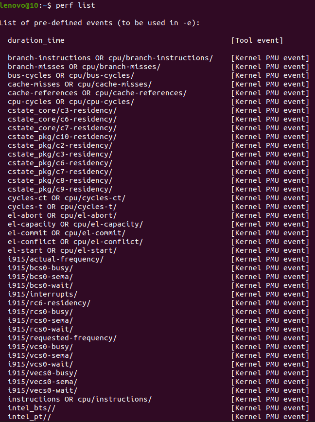

`perf list`命令输出的信息较长，每按一下回车就会多输出一行信息。按Q键即可退出。

#### 3. 查看`lab1_gemm`程序的缓存使用情况

  先通过`cd`命令进入`lab1/build`文件夹，再执行下列命令查看基本性能事件：

```bash
sudo perf stat ./dist/bins/lab1_gemm 256 256 256
```

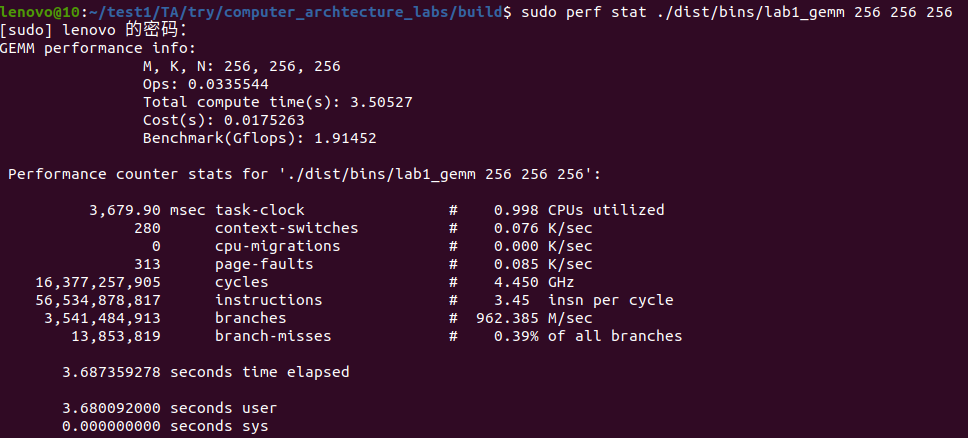

  添加`-e`选项，可查看指定的性能事件。所支持的性能事件可由`perf list`查看。

```bash
sudo perf stat -e L1-dcache-loads,L1-dcache-load-misses,dTLB-loads,dTLB-load-misses ./dist/bins/lab1_gemm 256 256 256
```

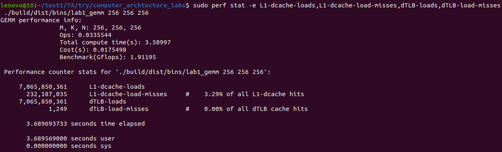


---

<!-- Section: 06_预习下一个实验.md -->
# 预习下一个实验

  阅读下述论文材料以了解设计高性能矩阵乘法计算内核的基本原则。

- 《Anatomy of High-Performance Matrix Multiplication》
- 《Analytical modeling is enough for high-performance BLIS》


---
