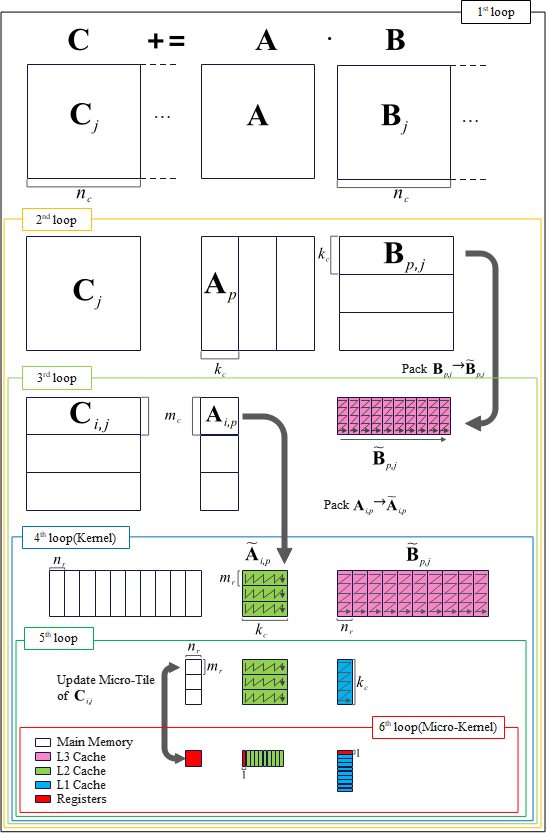
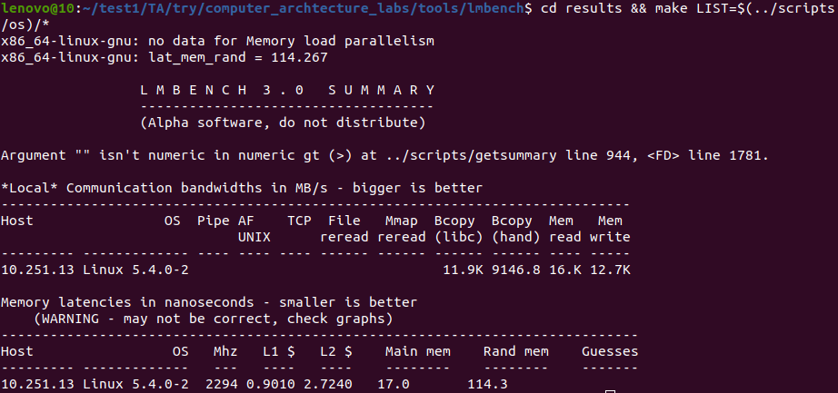
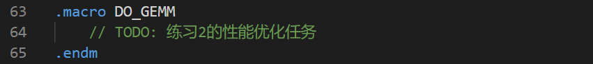
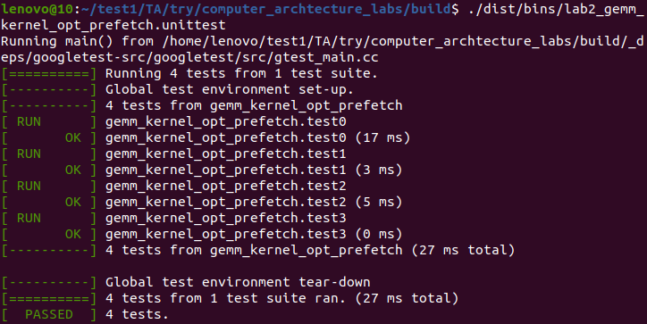
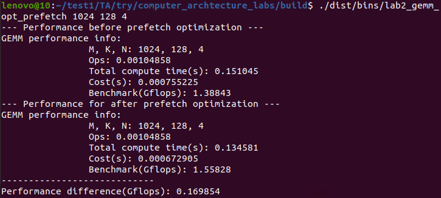
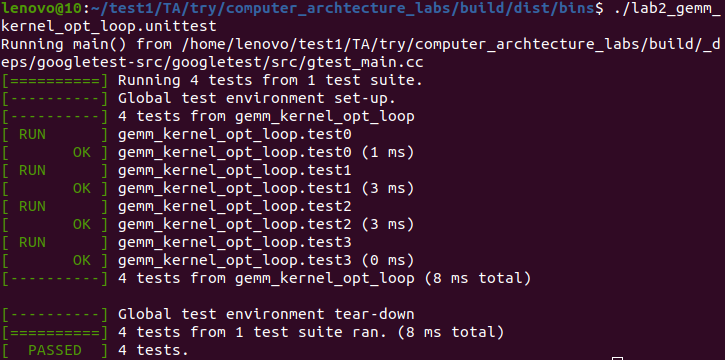
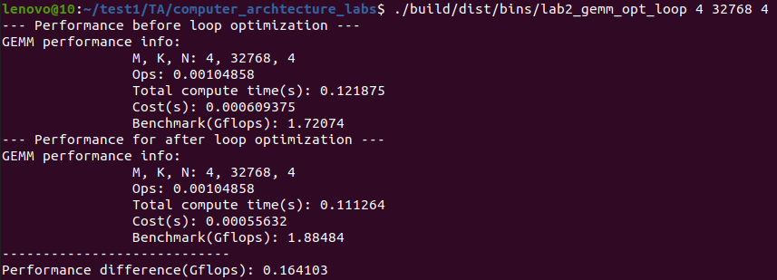

# 计算机体系结构实验 - 实验2指导书汇总

> 本文档为实验2所有章节的 1:1 完整汇总转译版，供离线阅读与后续 Agent 查阅。

## 目录导航

- [实验2：使用Cache优化矩阵乘法](./00_实验概述.md)
- [实验原理](./01_实验原理.md)
- [练习1：利用性能分析工具分析性能瓶颈](./02_练习1.md)
- [练习2：利用预取优化性能](./03_练习2.md)
- [练习3 (选做)：利用循环和分块提升计算性能](./04_练习3.md)
- [预习下一个实验](./05_预习下一个实验.md)

---

<!-- Section: 00_实验概述.md -->
# 实验2：使用Cache优化矩阵乘法

## 实验目的

  1. 理解计算机Cache原理，并掌握使用该原理优化矩阵乘法运算；

  2. 通过合理利用Cache优化矩阵乘法计算的数据访问路径，学习和应用指令级优化的一般步骤；

  3. 了解分析程序性能瓶颈和从指令层面对程序进行优化的基本方法。

## 实验前准备

  阅读下述论文材料以了解设计高性能矩阵乘法计算内核的基本原则。

- 《Anatomy of High-Performance Matrix Multiplication》
- 《Analytical modeling is enough for high-performance BLIS》

  实验环境：一台安装了`cmake`、`gcc`、`gdb`和`perf`环境且系统为ubuntu x64的计算机。

## 实验内容

  1. 利用性能分析工具分析性能瓶颈；

  2. 利用数据主动预取机制优化矩阵乘法的性能；

  3. 利用循环和分块提升矩阵乘法的计算性能。


---

<!-- Section: 01_实验原理.md -->
# 实验原理

## 1. 预取指令 `prefetch`

  x86-64指令集架构包含SSE（Streaming SIMD Extension）扩展指令。SSE扩展指令支持以SIMD方式实现数据的并行处理，有效提高了CPU的数据处理效率。

  SSE提供了用于把数据预取到Cache中的预取指令 `prefetch`，如表2-1所示。

表2-1 SSE扩展的预取指令

| 指令名称 | 指令功能 | 适用对象 |
| --- | --- | --- |
| `prefetcht0` | 预取数据到所有层级的Cache中 | 短期内多次访问的数据 |
| `prefetcht1` | 预取数据到L2 Cache及更高层级的Cache中 | 短期内多次访问的数据 |
| `prefetcht2` | 预取数据到L2 Cache及更高层级的Cache中 | 短期内多次访问的数据 |
| `prefetchnta` | 预取数据到某个层级的Cache（尽可能不影响Cache现有数据） | 短期内不需多次访问的数据 |

> [!NOTE] **prefetcht1和prefetcht2的区别**
>
> 以Intel处理器为例，厂商的[软件开发手册](https://www.intel.cn/content/www/cn/zh/content-details/782158/intel-64-and-ia-32-architectures-software-developer-s-manual-combined-volumes-1-2a-2b-2c-2d-3a-3b-3c-3d-and-4.html)对`prefetcht1`和`prefetcht2`的描述都是“fetch data into level 2 cache and higher”。实际`prefetcht1`会比`prefetcht2`更加倾向于把数据预取到更高层级的Cache，可以简单理解为，`prefetcht1`尽量把数据预取到L2 Cache，而`prefetcht2`则更多时候会把数据预取到L3 Cache。

  预取指令的使用方法是 `prefetch<t0/t1/t2/nta> (<byte_addr>)`。其中，`byte_addr`是 **字节地址**；预取的数据单元大小取决于具体的处理器实现，一般至少为32字节（通常是一个Cache缓存行的大小）。

  预取指令的执行是非阻塞的，即 `prefetch` 指令之后的指令不需要等待数据预取操作完成之后再执行。

## 2. 分块矩阵乘法与缓存优化

  目前主流线性代数库大多采用如图2-1所示的Goto算法及其变种算法计算矩阵乘法。Goto算法的核心是根据分块矩阵乘法算法的计算流程，将参与计算的数据块存入不同的缓存以期将数据的访问时间隐藏在分块计算中。

  经典的Goto算法采用如图2-1所示的六重循环，第4层循环到第6层循环通常被称为Kernel（内核），为了保证计算的效率，一般采用手写汇编的方式进行实现。

  图2-1中各参数的一般设置规律如下：

- 第6层循环中的 ,  与处理器核心中可使用的寄存器数量强相关。通常会将绝大多数的数据寄存器分给和矩阵  的分块（ 大小）, 以保证有足够的时间从L2缓存按行加载计算所需的矩阵  的数据，从L1D缓存加载矩阵  的数据。
- 第5层循环中  的设定一般需考虑  大小的矩阵  的数据能够占据L1D缓存的多数way，余下的way供矩阵  和矩阵  使用。此时矩阵  的数据会因为重复使用而停留在L1D缓存中。若  设置得过小，会导致第2层循环中矩阵  的部分和的累加次数增多，由于矩阵  保存在内存中，过多的累加会严重的拖慢计算速度。
- 第3层循环中  的认定一般需考虑  大小的矩阵  的数据能够占据L2缓存的多数way，计算时数据直接从L2缓存流向寄存器。
- 第1重循环中  的选择需保证第3层循环中矩阵  的数据能够占据L3绝大部分way。

  因为对矩阵进行分块后会带来分块元素访问不连续的问题，所以，通常情况下会在第3重循环和第4层循环对分块数据进行Packing以保证Kernel访问元素的连续性和空间局部性。需注意的是Packing本身有代价，并不总是能带来正向的收益，灵活的packing策略有助于提高矩阵乘法的计算性能。

  主流处理器的计算单元和访存单元通常为独立部件，这意味着计算的同时可以进行访存相关的操作。如果能够根据算法的计算流程和各级存储的访问代价(比如延迟，带宽)将矩阵乘法下一次所需的数据提前准备到对应位置，能大幅减少数据的读取时间获得更高的计算性能。需要注意提前准备数据不能引发剧烈的way冲突，也不能带来更严重的缓存驱逐。


图2-1 Goto算法的一般流程

  若需更系统的了解高性能矩阵乘法的设计和优化方法，请查阅以下资料：

- 《Anatomy of High-Performance Matrix Multiplication》
- 《Theory and Practice of Classical Matrix-Matrix Multiplication for Hierarchical Memory Architectures》
- 《Analytical modeling is enough for high-performance BLIS》


---

<!-- Section: 02_练习1.md -->
# 练习1：利用性能分析工具分析性能瓶颈

- **任务**：从访存层面分析示例代码的性能瓶颈。
- **目标**：学会利用perf性能分析工具分析示例程序的缓存命中率。
- **示例代码**：`lab2_gemm_baseline.S`

#### 0. 下载并解压实验包

  从[首页链接](../00_课程总览/00_课程概况.md)下载`lab2.tar.gz`，将其拷贝至用户目录，并执行命令`tar -zxvf lab2.tar.gz`解压实验包，然后执行`cd lab2`进入项目根目录。

#### 1. 编译生成待分析的二进制程序`lab2_gemm_baseline`

  在`lab2`目录下执行下列命令创建`build`目录：

```bash
mkdir -p build && cd build
```

  执行命令编译测试程序：

```bash
cmake -B . -S ../ && cmake --build ./ --target lab2_gemm_baseline
```

#### 2. 使用`perf stat`命令结合`-e`参数指定事件查看程序的性能事件并根据结果分析定位性能瓶颈点(指定的事件应随分析而变)

```bash
sudo perf stat -e L1-dcache-loads,L1-dcache-load-misses ./dist/bins/lab2_gemm_baseline 256 1024 256
```

> [!NOTE] **事件说明**
>
> `L1-dache-loads`：从L1 DCache读取数据的指令数量  
>   `L1-dcache-load-misses`：在L1 DCache中读取数据时发生缺失的次数

  由于perf版本原因，实际支持的事件可能有差异，可在`perf list`得到的事件表中自行选取需要的事件。


---

<!-- Section: 03_练习2.md -->
# 练习2：利用预取优化性能

- **任务**：通过为练习1代码增加数据主动预取机制提升矩阵乘法性能。
- **子任务**：

  - 利用[lmbench3](https://sourceforge.net/projects/lmbench/)获取各级缓存的访问延迟；
  - 利用访问延迟信息为预取指令选择合适的位置。
- **目标**：

  - 学会查阅处理器厂商的[软件开发手册](https://www.intel.cn/content/www/cn/zh/content-details/782158/intel-64-and-ia-32-architectures-software-developer-s-manual-combined-volumes-1-2a-2b-2c-2d-3a-3b-3c-3d-and-4.html)选取合适的指令（第一卷10.4.6节数据预取相关内容）；
  - 学会在指令流中为数据预取指令选择合适的位置。

#### 1. 运行`lmbench3`工具查看目标处理器信息

  注意：需多次运行取均值，单次运行时间约7小时，请合理安排重试次数。

> [!NOTE] **说明**
>
> 由于运行耗时较长，课上只需执行相关命令，了解`lmbench3`的用法和功能即可，不需等待其运行完毕。运行起来后，可通过快捷键 `Ctrl`+`C` 终止运行。

```bash
cd lab2/tools && tar xf lmbench.tgz && cd lmbench
make results
# 涉及的参数选择 
# MULTIPLE COPIES [default 1] 回车
# Job placement selection: 4
# MB [default 10956] 默认值会运行很久，可输入较小值后回车，如8192、4096等
# SUBSET (ALL|HARWARE|OS|DEVELOPMENT) [default all] HARWARE
# FASTMEM [default no] 回车
# SLOWFS [default no] yes
# DISKS [default none] 回车
# REMOTE [default none] 回车
# Processor mhz [default 2688 MHz, 0.3720 nanosec clock] 回车
# FSDIR [default /var/tmp] 回车
# Status output file [default /dev/tty] /tmp/lmbench.test
# Mail results [default yes] no

# 因为LMBENCH3对新系统的兼容问题，选择完后很快会失败，按下面的步骤继续操作即可
cp -a results ./bin/
make rerun

# 等待运行结束
mv results results.bak
cp -a ./bin/results ./
# 查看延迟信息（如果不够详细可以自行调整make results参数再进行测试）
cd results && make LIST=$(../scripts/os)/*
```



  在`lab2/tools`目录下可以找到“`10.251.137.194.0`”文件，这是`make results`指令的输出文件，根据上述的指令将其放入正确位置并执行`make rerun`之后的步骤即可。

#### 2. 根据上一步获得的存储信息，为练习1的代码增加数据预取优化（如`prefetch0`指令），形成`src/lab2/gemm_kernel_opt_prefetch.S`中`DO_GEMM`过程（第64行）中的矩阵计算逻辑

  注意：不需自行编写下图中的`DO_GEMM`过程，只需先将`gemm_kernel_baseline.S`中第62~105行`DO_GEMM`的代码替换掉`gemm_kernel_opt_prefetch.S`中的第63~65行，然后在此基础上添加预取优化代码即可。



#### 3. 验证kernel结果的正确性

  确保终端当前处于`lab2/build`目录下，然后执行下列命令：

```bash
cmake -B . -S ../ && cmake --build ./ --target lab2_gemm_kernel_opt_prefetch.unittest
./dist/bins/lab2_gemm_kernel_opt_prefetch.unittest
```



#### 4. 对比优化后的算法与基线的性能（测试用例根据自己的优化选择），根据对比结果分析优化方案的局限性

  在`lab2/build`目录下执行下列命令：

```bash
cmake -B . -S ../ && cmake --build ./ --target lab2_gemm_opt_prefetch
./dist/bins/lab2_gemm_opt_prefetch 1024 128 4
```




---

<!-- Section: 04_练习3.md -->
# 练习3 (选做)：利用循环和分块提升计算性能

- **任务**：

  - 修改练习2代码，设计恰当循环顺序和数量进一步提升矩阵乘法性能。
  - 本练习为选做内容，根据具体实现及加速效果加分。
- **目标**：

  - 学会通过优化算法提高缓存命中率；
  - 学会根据缓存大小优化矩阵乘法分块大小提升性能。

#### 1. 根据练习1的分析结果，完善`src/lab2/gemm_kernel_opt_loop.S`中`DO_GEMM`过程（第55行）的矩阵计算逻辑


#### 2. 验证kernel结果的正确性

  在`lab2/build`目录下执行下列命令：

```bash
cmake -B . -S ../ && cmake --build ./ --target lab2_gemm_kernel_opt_loop.unittest
./dist/bins/lab2_gemm_kernel_opt_loop.unittest
```



#### 3. 对比优化后的算法与基线的性能（测试用例根据自己的优化选择），根据对比结果分析优化方案的局限性

  在`lab2/build`目录下执行下列命令：

```bash
cmake -B . -S ../ && cmake --build ./ --target lab2_gemm_opt_loop
./dist/bins/lab2_gemm_opt_loop 4 32768 4
```



  尝试结合预取指令进一步优化算法，并对比优化前后的性能。


---

<!-- Section: 05_预习下一个实验.md -->
# 预习下一个实验

  阅读下述论文材料了解设计高性能矩阵乘法计算内核的基本原则和Intel处理器的特性。

- 《LIBXSMM: Accelerating Small Matrix Multiplications by Runtime Code Generation》
- 《[Intel® 64 和 IA-32 架构软件开发人员手册合并卷](https://www.intel.cn/content/www/cn/zh/content-details/782158/intel-64-and-ia-32-architectures-software-developer-s-manual-combined-volumes-1-2a-2b-2c-2d-3a-3b-3c-3d-and-4.html)》的第一卷和第二卷（第5章FPU相关内容，14章AVX指令相关内容等）


---
