# 计算机体系结构实验 - 实验3指导书汇总

> 本文档为实验3所有章节的 1:1 完整汇总转译版，供离线阅读与后续 Agent 查阅。

## 目录导航

- [实验3：使用指令级并行、向量指令和并行优化矩阵乘法](./00_实验概述.md)
- [实验原理](./01_实验原理.md)
- [练习1：基于x87 FPU优化矩阵乘法性能](./02_练习1.md)
- [练习2：基于AVX指令设计并实现高性能矩阵乘法计算内核](./03_练习2.md)
- [练习3 (选做)：基于OpenMP库和练习2实现的高性能计算内核实现任意形状的矩阵乘法计算](./04_练习3.md)
- [实验报告要求](./05_实验报告要求.md)
- [预习下一个实验](./06_预习下一个实验.md)

---

<!-- Section: 00_实验概述.md -->
# 实验3：使用指令级并行、向量指令和并行优化矩阵乘法

## 实验目的

  1. 理解计算机系统的指令级并行性；

  2. 通过循环展开、向量指令、多线程技术学习如何综合利用现代处理器的多种特性优化程序性能；

  3. 掌握利用指令级并行、向量指令和多线程技术进一步发掘处理器并行性能的方法。

## 实验前准备

  阅读下述论文材料了解设计高性能矩阵乘法计算内核的基本原则和Intel处理器的特性。

- 《LIBXSMM: Accelerating Small Matrix Multiplications by Runtime Code Generation》
- 《[Intel® 64 和 IA-32 架构软件开发人员手册合并卷](https://www.intel.cn/content/www/cn/zh/content-details/782158/intel-64-and-ia-32-architectures-software-developer-s-manual-combined-volumes-1-2a-2b-2c-2d-3a-3b-3c-3d-and-4.html)》的第一卷和第二卷（第5章FPU相关内容，14章AVX指令相关内容等）

  实验环境：一台安装了`cmake`、`gcc`、`gdb`和`perf`环境且系统为ubuntu x64的计算机。

## 实验内容

  1. 利用处理器的FPU，结合循环展开提升矩阵乘法性能；

  2. 基于AVX指令设计实现高性能矩阵乘法计算内核；

  3. 基于OpenMP库实现任意形状的矩阵乘法计算。


---

<!-- Section: 01_实验原理.md -->
# 实验原理

## 数据并行

  向量指令能够加速的原理主要基于 SIMD（单指令多数据）技术。SIMD 允许单条 CPU 指令同时对多个数据执行操作，这样可以显著提高处理大量数据时的效率。

  向量指令能够加速的关键原理如下:

- 并行处理多个数据元素: 向量指令允许处理器同时操作多个数据元素，这些数据元素通常存储在一个向量寄存器中。例如，一条向量加法指令可以同时将两个向量寄存器中的对应元素相加，并将结果存储在另一个向量寄存器中。这意味着一条指令可以完成多个标量操作，从而显著提高数据处理的速度。
- 更高效的内存访问: 向量指令通常设计成能有效地处理连续内存中的数据。由于数据在内存中通常是连续存放的，因此向量加载和存储指令可以一次读取或写入多个连续的数据元素，减少了内存访问次数，提高了带宽利用率。
- 优化的数据路径：现代处理器内部包含专门设计用于向量运算的数据路径。这些路径通常具有更高的吞吐量，并且针对向量运算进行了优化，使得在执行诸如向量加法、乘法等操作时比传统的标量运算更快。
- 减少分支预测错误：在执行非向量代码时，分支预测错误会导致流水线停顿，从而降低性能。而向量指令通常涉及的是简单的算术逻辑操作，没有复杂的条件判断，因此减少了因分支预测错误带来的性能损失。
- 提高指令级并行度（ILP）：向量指令可以通过在每个时钟周期内执行更多操作来提高处理器的指令级并行度。这使得处理器可以在同一时间内处理更多的计算任务，从而提高整体性能。

  现代处理器大多支持 SIMD 指令，如 Intel 的 SSE、AVX 或 ARM 的 NEON、SVE。若需了解更多处理器对 SIMD 指令的支持情况请查阅处理器厂商提供的使用手册。

  利用数据并行实现加速的常用方法包括循环展开、使用向量指令，以及使用基于共享内存实现多线程并行编程的 OpenMP 库。

### 1. 循环展开

  为了充分发挥流水线 CPU 的性能，必须尽量减少流水线停顿，使其满负荷运行。因此，需要充分开发指令之间存在的并行性，找出不相关的指令序列，使其在流水线中重叠执行。

  循环展开（Loop Unrolling）是指将循环体的代码复制多次并按顺序排放，然后相应调整循环结束的条件。循环展开能够挖掘循环的不同迭代之间存在的并行性 —— 原本多个迭代的循环体代码能够在循环展开后被合并起来，给编译器和处理器提供更大的调度和优化空间。此外，循环展开后，循环次数成倍减少，从而分支指令和循环控制的开销也随之降低。

### 2. AVX指令

[MMX（MultiMedia eXtension）](https://www.intel.com/content/dam/www/public/us/en/documents/research/1997-vol01-iss-3-intel-technology-journal.pdf)、[SSE（Streaming SIMD Extension）](https://www.intel.com/content/dam/develop/external/us/en/documents/d9156103-705230.pdf)和 [AVX（Advanced Vector eXtensions）](https://www.intel.com/content/www/us/en/developer/technical-library/overview.html?f:@stm_10309_en=%5BIntel%C2%AE%20Technologies%3BIntel%C2%AE%20Data%20Center%20Technologies%3BIntel%C2%AE%20Advanced%20Vector%20Extensions%20(Intel%C2%AE%20AVX)%5D)都是 Intel 处理器的 SIMD 指令集。其中，AVX 在 MMX 和 SSE 指令集的基础上，将128位的 SIMD 寄存器扩展至256位及以上，并且增加了对非结构化操作以及3操作数甚至4操作数的支持，提升了指令的灵活性和功能性。此外，AVX 指令集支持融合的乘加指令 FMAdd（Fused-Multiply-Add），能够通过单条指令实现形如  的乘加运算。

  AVX 具有16个256位的向量寄存器 YMM0 ~ YMM15。一个 AVX 寄存器能够存储8个32位单精度浮点数（或4个64位双精度浮点数），存储单个数据的字段称为向量寄存器的单元或元素（Element），如图2-1所示。

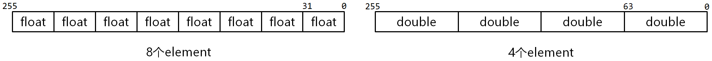
图2-1 向量寄存器的单元

  使用 AVX 指令进行运算时，需先将数据从内存加载到 AVX 寄存器，并在运算完毕后，再将运算结果从 AVX 寄存器保存回内存中。

  常用的 AVX 指令如表2-1所示。

表2-1 AVX 常用指令

| 指令 | 说明 | 使用示例 |
| `vbroadcastss` `vbroadcastsd` `vbroadcastf128` | 从内存加载一个 32位 / 64位 / 128位 的操作数，并将其广播到向量寄存器的每个单元中 | `vbroadcastss (%rax), %ymm0` 设`d=MEM[%rax]`，则指令执行后，`ymm0`寄存器为： |
| `vmovups` `vmovdqu` `vmovapd` | 在内存和AVX寄存器之间移动 未对齐的单精度 / 未对齐的双精度 / 对齐的双精度 浮点数 | `vmovups %ymm0, (%rax)` 将`ymm0`寄存器中的8个float浮点数存储到`MEM[%rax]` |
| `vfmadd231ps` `vaddps` `vsubps` `vmulps` `vdivps` `vsqrtps` | 执行256位的 乘加 / 加 / 减 / 乘 / 除 / 开平方 运算，指令后缀的`s`表示操作数类型是单精度浮点 | `vfmadd231ps %ymm0, %ymm1, %ymm2` 计算`ymm2 += ymm0 * ymm1`，且对向量寄存器的每个单元，均有`ymm2[i] += ymm0[i] * ymm1[i]` |

### 3. OpenMP

  OpenMP（Open specifications for Multi Processing）是一个支持以共享内存方式实现多线程并行处理的编程库。OpenMP提供嵌入到高级语言的编译指令/原语，从而将串行代码并行化。OpenMP支持不同粒度的并行化。此外，OpenMP简化了线程的使用，不需要开发者自行考虑线程的创建、同步、负载均衡等操作。

  使用OpenMP实现多线程并行加速的基本步骤包括计算任务划分、数据传输、子任务结果整合、子任务计算逻辑实现、线程创建等，详情可参考[OpenMP的官方文档](https://www.openmp.org/)。

  以下介绍常用优化语句的作用及使用方法。

- 并行执行代码（**`parallel`**）

```
#pragma omp parallel num_threads(thrd_num)
{
    int thread_id   = omp_get_thread_num();    // 当前线程ID
    int threads_num = omp_get_num_threads();   // 总线程数
    /* some code */;    // 使用thrd_num个线程并行执行
}
```

  若没有显式指定线程数，则OpenMP将在运行时根据硬件配置、系统负载等情况创建线程。

- 线程任务分配（**`sections`**、**`section`**）

```
#pragma omp parallel sections
{
    #pragma omp section
    func1();    // 线程1执行

    #pragma omp section
    func2();    // 线程2执行
}
```

- `for`循环并行化（**`parallel for`**）

```
#pragma omp parallel for
for (int i = 0; i < N; i++)  // 若干个线程并行执行循环体
{
    /* some code */;    // 此处代码不能写同一个共享变量，否则计算结果错误
}
```

- 计算结果归并（**`reduction`**）

```
#pragma omp parallel for reduction(+:sum)
for (int i = 0; i < N; i++)  // 若干个线程并行执行循环体
{
    sum += a[i] * b[i];
}
```

- 线程同步（**`barrier`**、**`critical`**、**`atom`**）

```
#pragma omp parallel
{
    func1();   // 所有线程执行完func1()后再执行后续代码
    #pragma omp barrier
    func2();
}
```
```
#pragma omp parallel for
for (int i = 0; i < N; i++)
{
    #pragma omp critical
    // 同一时刻只有一个线程执行代码块
    {
        /* some code */;
    }
}
```

  若`critical`下的代码块内只有一条语句，可改用开销更低的`atom`：

```
#pragma omp parallel for
for (int i = 0; i < N; i++)
{
    #pragma omp atom
    cnt++;    // 同一时刻只有一个线程执行此代码
}
```


---

<!-- Section: 02_练习1.md -->
# 练习1：基于x87 FPU优化矩阵乘法性能

- **任务**：利用处理器中的x87 FPU（浮点计算单元）中更多的寄存器对矩阵乘法计算的循环进行展开以提升性能。
- **子任务**：

  - 使用`FLD`、`FSTP`等指令操作数据的读取与存储；
  - 使用`FMUL`、`FADDP`等x87 FPU提供的指令进行计算；
  - 以2为步进对  维度的循环进行展开（可参考`src/lab3/gemm_kernel_baseline.S`中的 `DO_LOOP_N` 逻辑）
- **目标**：学会利用计算单元的特性进行循环展开。

> [!TIP] **关于浮点指令**
>
> 本实验涉及x87 FPU的通用寄存器栈以及`FLD`、`FSTP`、`FMUL`、`FADDP`等常用指令，相关内容可自行回顾[实验1 - 实验原理 - 第3节 x87 FPU](../实验1/01_实验原理.md)。

#### 0. 下载并解压实验包

  从[首页链接](../00_课程总览/00_课程概况.md)下载`lab3.tar.gz`，将其拷贝至用户目录，并执行命令`tar -zxvf lab3.tar.gz`解压实验包。

#### 1. 在`src/lab3/gemm_kernel_opt_loop_unrolling.S`第83行添加计算`A[m][k]*B[k][n+1]->st(0)`的逻辑

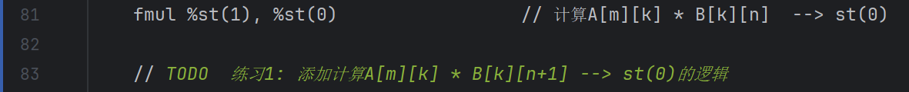

#### 2. 在`src/lab3/gemm_kernel_opt_loop_unrolling.S`第91行添加加载`C[m][n]->st(1)`和加载 `C[m][n+1]->st(0)`的逻辑


#### 3. 在`src/lab3/gemm_kernel_opt_loop_unrolling.S`第93行添加部分和累加逻辑: `C[m][n+1] + A[m][k] * B[k][n+1]` 和 `C[m][n] + A[m][k] * B[k][n]`

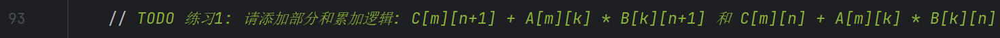

#### 4. 在`src/lab3/gemm_kernel_opt_loop_unrolling.S`第97行添加保存`C[m][n]`的逻辑


#### 5. 在`src/lab3/gemm_kernel_opt_loop_unrolling.S`第99行添加N维度的循环更新逻辑


#### 6. 验证循环展开方案的正确性

```
# 项目根目录下执行
mkdir -p build && cd build
cmake -B . -S ../ && cmake --build ./ --target lab3_gemm_opt_loop_unrolling.unittest
./dist/bins/lab3_gemm_opt_loop_unrolling.unittest
```

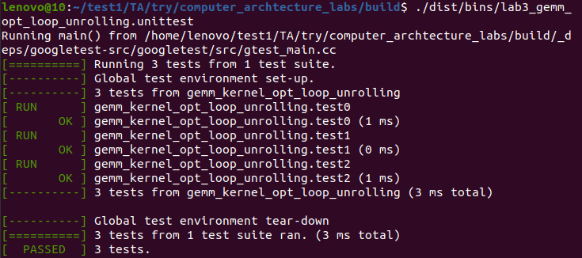

#### 7. 对比优化后的算法与基线的性能（测试用例根据自己的优化选择），根据对比结果分析优化方案的局限性

```
# build目录下执行
cmake -B . -S ../ && cmake --build ./ --target lab3_gemm_opt_loop_unrolling
./dist/bins/lab3_gemm_opt_loop_unrolling 256 256 256
```

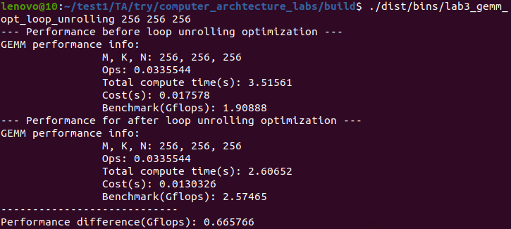

#### 8. 测试并对比不同循环展开度的性能差异

  循环展开度指的是在每轮循环中，原始循环体被重复执行的次数。

  测试不同循环展开度（比如0（即无循环展开）、2、4等）的性能差异，绘制性能变化曲线图并进行合理分析。


---

<!-- Section: 03_练习2.md -->
# 练习2：基于AVX指令设计并实现高性能矩阵乘法计算内核

- **任务**：利用AVX指令实现性能更好的矩阵乘法计算内核。
- **子任务**：

  - 计算内核  矩阵（）的元素个数不少于64，即 ；
  - 计算内核各维度必须满足如下要求: ，，；
  - 计算内核采用流水线设计读取、计算、写回等过程。
- **目标**：学会利用向量指令实现计算性能更高的矩阵乘法计算单元。

#### 0. 模板代码`src/lab3/gemm_kernel_opt_avx.S`的实现思路

  模板代码`src/lab3/gemm_kernel_opt_avx.S`采用如下图所示的矩阵分块算法：

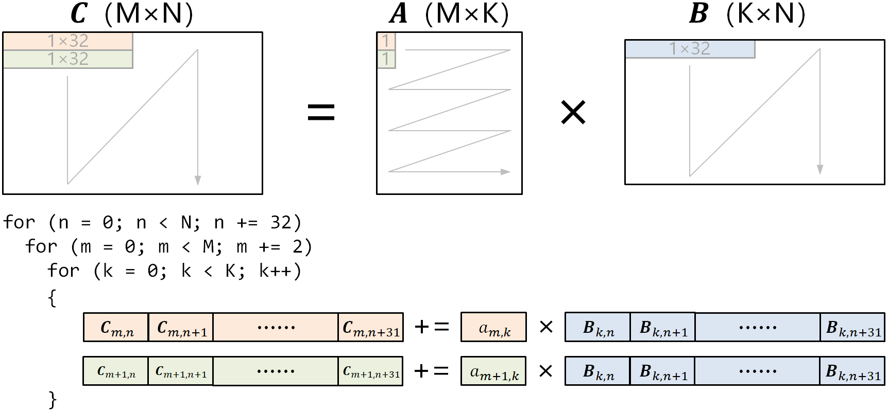

  最内层循环每次使用  的`A[m:m+2][k]`分块和  的`B[k][n:n+32]`分块计算出  的`C[m:m+2][n:n+32]`分块。最内层的分块矩阵乘法采用 AVX 向量指令实现并行计算。

#### 1. 为`src/lab3/gemm_kernel_opt_avx.S`的`LOAD_MAT_C`过程（第110行、第117行）添加加载`C[m:m+2][n:n+32]`到AVX寄存器的逻辑

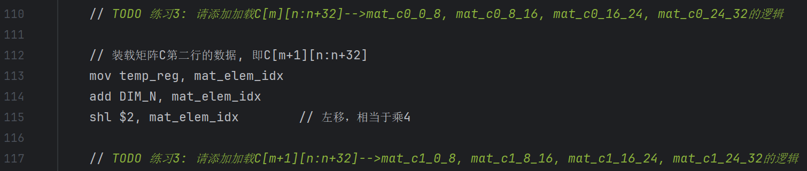

#### 2. 为`src/lab3/gemm_kernel_opt_avx.S`的`LOAD_MAT_A`过程（第90行）添加加载`A[m+1][k]`到AVX寄存器的逻辑

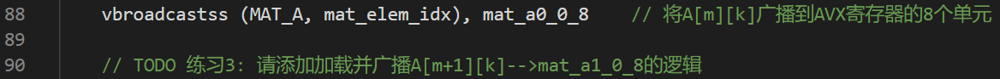

#### 3. 为`src/lab3/gemm_kernel_opt_avx.S`的`LOAD_MAT_B`过程（第96行）添加加载`B[k][n:n+32]`到AVX寄存器的逻辑


#### 4. 为`src/lab3/gemm_kernel_opt_avx.S`的`DO_COMPUTE`过程（第141行）添加计算`C[m:m+2][n:n+32]+=A[m:m+2][k]*B[k:k+8][n:n+32]`的逻辑

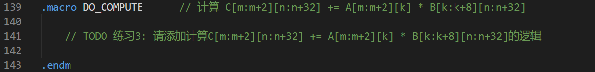

#### 5. 为`src/lab3/gemm_kernel_opt_avx.S`的`STORE_MAT_C`过程（第132行、第135行）添加保存`C[m][n:n+32]`和`C[m+1][n:n+32]`的逻辑


#### 6. 验证新内核的正确性

```
# build目录下执行
cmake -B . -S ../ && cmake --build ./ --target lab3_gemm_opt_avx.unittest
./dist/bins/lab3_gemm_opt_avx.unittest
```

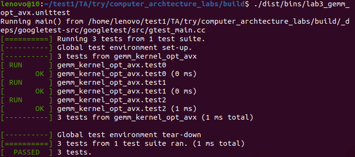

#### 7. 对比优化后的算法与基线的性能（测试用例根据自己的优化选择），根据算法和结果分析优化方案的优缺点。

```
# build目录下执行
cmake -B . -S ../ && cmake --build ./ --target lab3_gemm_opt_avx
./dist/bins/lab3_gemm_opt_avx 256 256 256
```

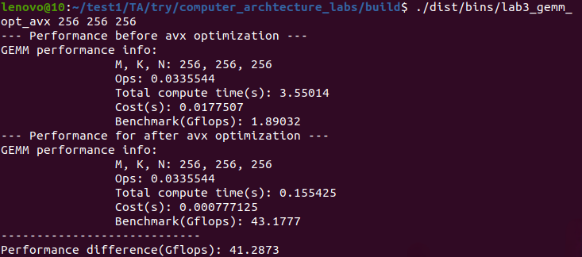

#### 8. 测试并对比新内核在不同数据规模下的性能差异

  改变输入矩阵的数据规模（比如边长为32、64、128等），测试AVX矩阵乘法内核的性能数据，绘制性能变化曲线图并进行合理分析。


---

<!-- Section: 04_练习3.md -->
# 练习3 (选做)：基于OpenMP库和练习2实现的高性能计算内核实现任意形状的矩阵乘法计算

- **任务**：利用OpenMP库将练习2实现的单线程高性能矩阵乘法内核扩展到多核以实现计算更大规模的矩阵乘法的目标。
- **子任务**：

  - 矩阵乘法能够利用多线程实现对 ，，形状的计算；
  - 切分后不满足练习2内核要求大小的数据块允许采用Padding或另行设计内核的方式进行计算；
  - 自行设计各个维度的并行策略但线程总数不能超过函数参数中指定的线程总数；
  - 计算性能需超过基线。
- **目标**：学会利用不同层级的并行策略对程序进行加速。

> [!NOTE] **练习说明**
>
> 本练习的并行优化策略属于开放性内容，没有严格意义上的最优方案。

#### 0. 模板代码`src/lab3/openmp_gemm_baseline.cpp`的实现思路

  模板代码`src/lab3/openmp_gemm_baseline.cpp`采用如下图所示的多线程矩阵分块算法：

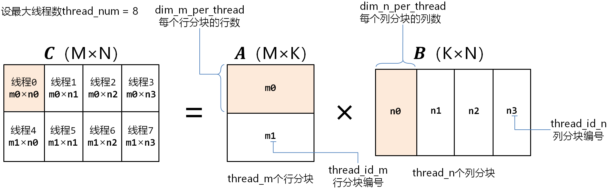

  第6行~第13行的`get_parallel_thread_num`函数使用最大线程数`max_threads`计算矩阵`A`的行分块数`m_thread`和矩阵`B`的列分块数`n_thread`。其中，矩阵`A`最多只被切分成2个行分块。

  第15行`openmp_gemm_baseline`函数的`thread_num`参数表示计算使用的最大线程数，可通过命令行参数传递。

  第22行~第26行使用编译指令描述线程创建的线程数、共享变量（矩阵`C`）、私有变量等配置信息。其后包含在大括号里的第27行~第100行是每个线程需要执行的代码。

  第29行获取线程 ID。第一个线程 ID 为0，第二个线程 ID 为1，依此类推。

  第31行、第32行将线程 ID 映射到矩阵`A`行分块的编号`thread_id_m`、矩阵`B`列分块的编号`thread_id_n`。例如，假设 ID 为6的线程映射到的行分块编号是1，列分块编号是2，则表示6号线程将计算矩阵`A`第1个行分块和矩阵`B`第2个列分块的矩阵乘法。

  第36行、第41行分别计算矩阵`A`每个行分块的行数`dim_m_per_thread`、矩阵`B`每个列分块的列数`dim_n_per_thread`。

  第48行~第52行计算矩阵`A`第`thread_id_m`个行分块的开始行号`thread_m_start`和结束行号`thread_m_end`。

  第55行~第59行计算矩阵`B`第`thread_id_n`个列分块的开始列号`thread_n_start`和结束列号`thread_n_end`。

  第62行~第67行根据分块大小分配空间并初始化。

  第70行~第84行根据线程 ID 对应的行分块编号`thread_id_m`和列分块编号`thread_id_n`，将对应分块的数据从原始矩阵`A`、`B`、`C`拷贝到临时矩阵`A_padding`、`B_padding`、`C_padding`。

  第87行~第95行调用练习2的`gemm_kernel_opt_avx`内核计算分块矩阵乘法，并将计算结果保存回原始矩阵`C`。

#### 1. 按子任务要求，参考`src/lab3/openmp_gemm_baseline.cpp`，利用OpenMP库设计基于多核的支持更大规模的矩阵乘法计算的算法，并将逻辑填入`src/lab3/openmp_gemm_opt.cpp`指定位置（第7行）

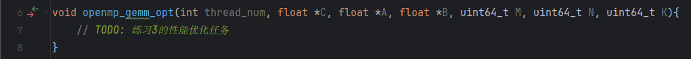

#### 2. 验证新算法的正确性

```
# build目录下执行
cmake -B . -S ../ && cmake --build ./ --target lab3_gemm_opt_openmp.unittest
./dist/bins/lab3_gemm_opt_openmp.unittest
```

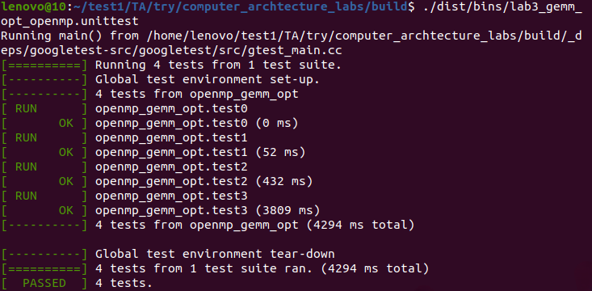

#### 3. 对比优化后的算法与基线的性能（测试用例根据自己的优化选择），根据算法和结果分析优化方案的优缺点

```
# build目录下执行
cmake -B . -S ../ && cmake --build ./ --target lab3_gemm_opt_openmp
./dist/bins/lab3_gemm_opt_openmp 8 512 512 512
```

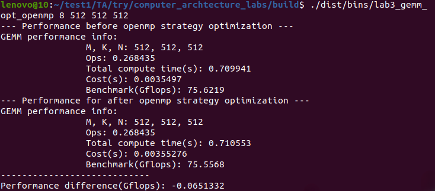

> [!NOTE] **实验结果说明**
>
> 以上截图中的性能对比双方均为未优化的 baseline 方案，此处仅作为实验过程的示例和参考。同学们进行此步骤时应使用步骤1实现的优化后的 `openmp_gemm_opt.cpp` 与 baseline 进行对比。


---

<!-- Section: 05_实验报告要求.md -->
# 实验报告要求

  完成实验1 ~ 实验3，点击下载[实验报告模板](../templates/1 CPU优化专题（实验1~3）报告模板.docx)，按以下要求撰写实验报告。

1. 实现流程（完整包含实验1~3的练习；结合关键代码/原理图以文字形式表述）；
2. 测试结果及原理分析（结合测试结果截图、测试数据表、文字等，对比分析Cache优化和数据并行优化的效果并描述相关原理）。

  将 **报告转成pdf格式**，提交前自行检查有无乱码、图片显示是否正常等。

  提交时，把以下内容压缩成.zip提交到作业系统。

```
- 学号-姓名.zip
    - 报告-学号-姓名.pdf        // 用模板撰写，转成pdf提交
    - src
        - gemm_kernel_opt_prefetch.S        // 实验2: 练习2
        - gemm_kernel_opt_loop.S            //       练习3（选做）
        - gemm_kernel_opt_loop_unrolling.S  // 实验3: 练习1
        - gemm_kernel_opt_avx.S             //       练习2
        - openmp_gemm_opt.cpp               //       练习3（选做）
```

  提交截止时间以作业系统为准。截止后有补交通道，但会扣迟交分。


---

<!-- Section: 06_预习下一个实验.md -->
# 预习下一个实验

  阅读以下材料，了解CUDA编程的基本原理及GPU架构的特性，以实现高效的矩阵乘法计算。

- 《CUDA C Programming Guide》


---
