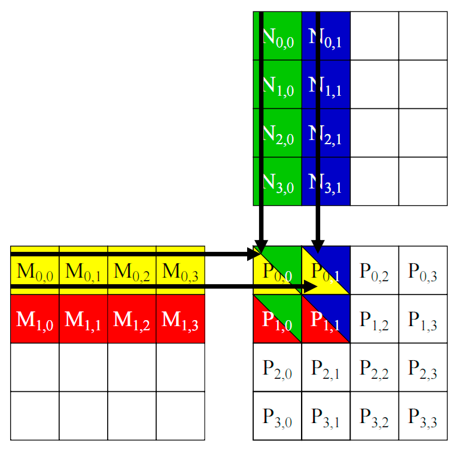
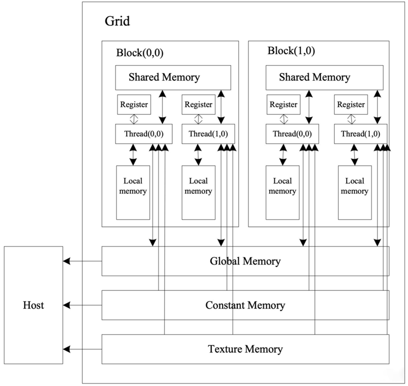
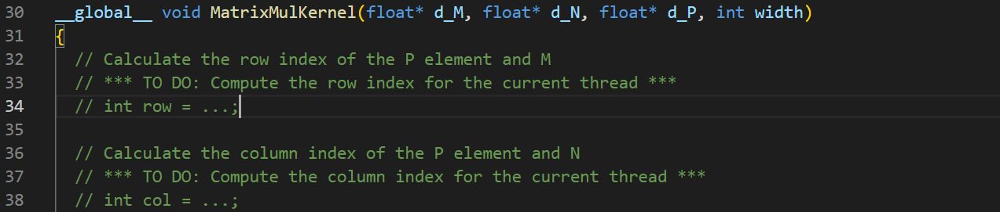
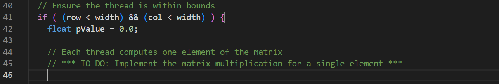
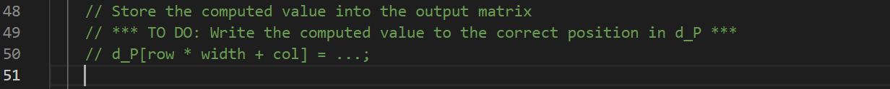
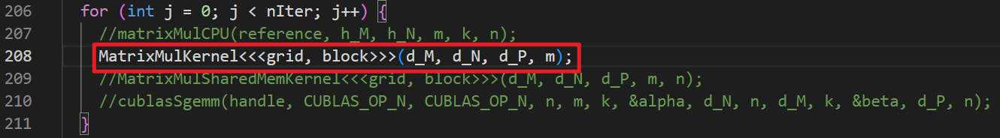
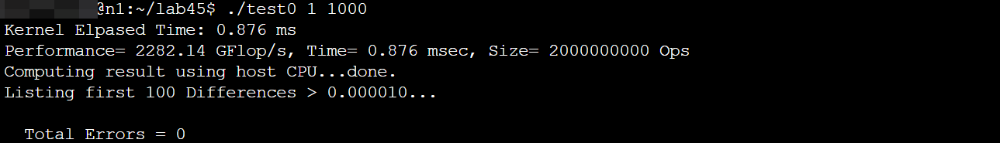
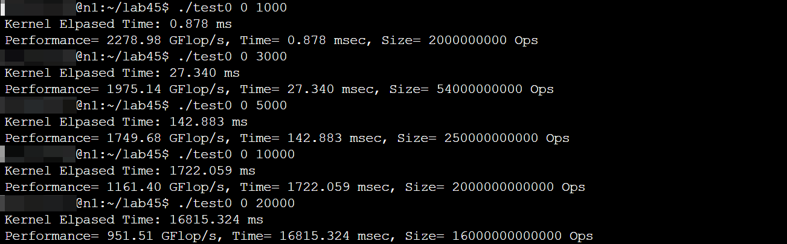
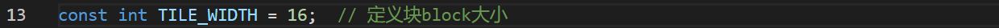

# 计算机体系结构实验 - 实验4指导书汇总

> 本文档为实验4所有章节的 1:1 完整汇总转译版，供离线阅读与后续 Agent 查阅。

## 目录导航

- [实验4：使用 C/CUDA 编写 GPU 代码](./00_实验概述.md)
- [实验原理](./01_实验原理.md)
- [实验步骤](./02_实验步骤.md)
- [预习下一个实验](./03_预习下一个实验.md)

---

<!-- Section: 00_实验概述.md -->
# 实验4：使用 C/CUDA 编写 GPU 代码

## 实验目的

  1. 了解 GPU 基本硬件架构及其并行计算模型；

  2. 学习如何利用 GPU 的多线程并行计算能力提升程序性能；

  3. 掌握 CUDA 的基本编程模型和线程调度方式，理解如何在 GPU 上进行高效的矩阵运算，从而进一步挖掘计算设备的并行处理能力。

## 实验前准备

  阅读以下材料，了解 CUDA 编程的基本原理及 GPU 架构的特性，以实现高效的矩阵乘法计算。

- 《CUDA C Programming Guide》

  实验环境：一台安装了 CUDA Toolkit、NVIDIA 驱动程序和相关开发工具（如`nvcc`、`cuda-gdb`等）的计算机，操作系统为 Ubuntu x64。

## 实验内容

  1. 使用 C/CUDA 实现 GPU上 的矩阵乘法算法；

  2. 观察和对比不同尺寸的输入矩阵，以及不同块大小下的矩阵乘法的计算结果。


---

<!-- Section: 01_实验原理.md -->
# 实验原理

## 矩阵乘法及CUDA优化

  在本实验中，我们将学习如何使用 CUDA（Compute Unified Device Architecture）进行并行编程，以加速矩阵乘法计算。CUDA 是由 NVIDIA 推出的并行计算平台和编程模型，它允许开发者利用 GPU 的计算能力来处理大规模并行计算任务。利用 CUDA 编写的程序可以显著提升矩阵乘法的计算性能，使得处理大规模矩阵变得更加高效。

  在矩阵乘法中，对于两个矩阵  和 ，它们的乘积矩阵  的每个元素可以通过以下公式计算得到

  其中， 表示矩阵  的第  行第  列元素。计算矩阵  的每个元素需要遍历矩阵  的行和矩阵  的列，因而时间复杂度为 ，对于大规模矩阵而言计算量非常大。

  CUDA 用于加速矩阵乘法计算的原理是基于 GPU 的大规模并行计算架构，通过让多个线程协作以实现高效的数据处理。以下是 CUDA 加速矩阵乘法的关键原理：

- 多线程并行计算：CUDA 通过 GPU 上成千上万的并行线程来加速计算。在矩阵乘法中，每个元素的计算是相互独立的，CUDA 可以将每个计算任务分配给一个线程，多个线程同时执行，从而极大地提高计算效率。
- 块和网格结构：在 CUDA 中，线程被组织成线程块和网格。每个线程块负责计算矩阵的一部分，并在共享内存中存储中间计算结果。这种分层结构允许更好的内存管理和并行处理。例如，可以将一个线程块的每个线程分配给结果矩阵中的一个元素计算任务。
- 隐藏内存延迟：GPU 拥有极高的线程数量，这些线程通过切换掩盖内存延迟。当某些线程因内存读取而被阻塞时，其他线程可以继续执行，从而能够有效地隐藏延迟，使计算单元保持高利用率。
- 并行计算能力与指令级并行度（ILP）：CUDA 架构支持在每个时钟周期内执行多个指令。通过将指令流水线优化为并行执行路径，CUDA 能够加速矩阵乘法等计算任务，并使得在同一时间内完成更多操作，提高整体计算效率。
- 计算密集型与内存密集型平衡：在矩阵乘法中，CUDA 可以通过调节线程数、块大小和内存分配策略，使得计算和内存访问得到优化平衡，从而更好地利用 GPU 资源。


图2-1 CUDA计算矩阵乘

  如图2-1所示，每个线程负责计算结果矩阵  中的一个元素。矩阵  和矩阵  都存储在全局内存中。每个线程从全局内存中读取  的一行和  的一列，然后执行点积运算得到  中的一个元素。

  通过这些并行处理技术，CUDA 在计算密集型任务（如矩阵乘法）中能够显著加速计算过程，从而在科学计算、图像处理等领域中得到广泛应用。

### 1. GPU 结构简介

  GPU 主要由流处理器阵列和存储系统组成，其结构如图2-2所示。


图2-2 GPU 结构示意图

  单个流处理器称为 GPU 的一个线程（Thread）。所有 Thread 被组织成 “线程格（Grid） - 线程块（Block） - 线程” 的层次结构。GPU 内包含多个 Grid，一个 Grid 包含多个 Block，一个 Block 包含多个 Thread。根据不同的应用场景，这些结构可以在逻辑上视为二维、三维甚至更高维度的组织方式。

  每个 Thread 具有私有的寄存器和局部存储器（Local Memory）。同属一个 Block 的所有 Thread 共享线程块中的共享存储器（Shared Memory）。所有 Block 共享全局存储器（Global Memory）、常量存储器（Constant Memory）和针对数据局部性进行优化的高性能存储器（Texture Memory），且 Host 与 GPU 也共享这三个存储器。在计算时，Host 需要先将待处理数据批量传输到这些存储器，由 GPU 处理完毕后再从这些存储器读回运算结果。

### 2. CUDA 程序基本组成

  CUDA 程序主要由 Host 代码与核函数组成。Host 代码通常是一段运行在 Host（即CPU）上的 C/C++ 程序，其作用是申请存储空间、预处理数据、拷贝数据、分配计算所需的 CUDA 线程数、调用核函数等。核函数则是运行在 Device（即GPU）的硬件线程（或核心）上的代码，故被称为核函数。

  下面是一个矩阵加法的 CUDA 示例程序：

```c
// Device核函数（运行在GPU的硬件线程上）
__global__ void matrixAdd(float A[Ny][Nx], float B[Ny][Nx], float C[Ny][Nx]) 
{
    // 获取矩阵元素的行号、列号
    int row = blockIdx.y * blockDim.y + threadIdx.y;
    int col = blockIdx.x * blockDim.x + threadIdx.x; 

    C[row][col] = A[row][col] + B[row][col];
}

// Host代码（运行在CPU上）
int main()
{
    ......

    const int Nx = 12; 
    const int Ny = 6;

    // 定义一个Block包含4*3个Thread
    dim3 threadsPerBlock(4, 3); 
    // 定义一个Grid包含3*2个Block
    dim3 numBlocks(Nx/threadsPerBlock.x, Ny/threadsPerBlock.y); 
    // 使用72个线程并行执行核函数（6个线程块，每个12线程）
    matrixAdd<<<numBlocks, threadsPerBlock>>>(A, B, C);

    ......
}
```

- Line 14 ~ 18：定义变量、分配空间、预处理数据、拷贝数据等。
- Line 20 ~ 22：定义 Grid 和 Block 的大小。
- Line 24：使用定义好的 Grid 和 Block 参数调用核函数执行矩阵加法，所有线程将并行执行核函数中的代码。
- Line 2：使用`__global__`关键字声明核函数。
- Line 5 ~ 6：使用 Block 和 Thread 的尺寸属性计算矩阵元素的行号和列号。`blockIdx`表示当前正在执行核函数的 Thread 所在的 Block 索引，`blockIdx.x`和`blockIdx.y`分别表示 Block 在 x 轴（横轴）和 y 轴（纵轴）方向的坐标。`blockDim`表示当前 Block 的尺寸，`blockDim.x`和`BlockDim.y`分别表示当前 Block 的列数和行数。`threadIdx`同理。


---

<!-- Section: 02_实验步骤.md -->
# 实验步骤

- **任务**：在模板代码基础上完成 CUDA 矩阵乘法的实现。
- **子任务**：

  - 验证 GPU 矩阵乘法结果的正确性；
  - 测试不同规模的矩阵乘法，观察实验结果。
- **目标**：

  - 熟悉 GPU 编程模型；
  - 学习 CPU 实现矩阵乘法实现思路；
  - 熟悉 CUDA 文件编译和执行过程。
- **实验代码**：`matrix_mul.cu`

#### 0. 下载并解压实验包

  从[首页链接](../00_课程总览/00_课程概况.md)下载`lab4-5.tar.gz`，将其拷贝至用户目录，并执行命令`tar -zxvf lab4-5.tar.gz`解压实验包。

#### 1. 打开`lab4-5`目录中的模板代码`matrix_mul.cu`，在30行处的`MatrixMulKernel`函数下实现 CUDA 矩阵乘的代码。将结果矩阵的位置索引计算代码填入指定位置（第34、38行）



#### 2. 将计算矩阵乘结果的`for`循环写入到指定位置（第46行），每个线程计算矩阵 C 一个元素的值



#### 3. 将计算结果赋值给结果矩阵的对应位置（第51行）



#### 4. 检查`main`函数是否调用`MatrixMulKernel`函数



#### 5. 保存文件，执行编译命令脚本，执行可执行文件`a.out`

```
bash compile.sh
./a.out 1 1000
```

  在命令`./a.out 1 1000`中，“`1`”表示对矩阵乘法运算结果进行校验，“`1000`”表示测试时输入方阵的边长。

> [!NOTE] **compile.sh中的编译命令**
>
> 打开`compile.sh`可知脚本使用`nvcc`对`matrix_mul.cu`程序进行编译。其中，选项`-arch=compute_35`用于指定GPU显卡的计算能力（Compute Capability），比如`compute_35`表示计算能力为`3.5`。自行安装环境的同学，需要从[GPU厂商官网](https://developer.nvidia.com/cuda-gpus)查询显卡对应的Compute Capability，并相应地修改`-arch`选项的值。

#### 6. 查看计算GPU计算矩阵乘时间和计算结果是否正确



#### 7. 更改矩阵尺寸（矩阵为方阵）、第13行的线程块大小`TILE_SIZE`（线程块也是方阵），对比不同参数下的计算结果






---

<!-- Section: 03_预习下一个实验.md -->
# 预习下一个实验

  阅读以下资料，以了解如何在CUDA中使用共享内存优化矩阵乘法的基本原理。

- 《CUDA C Programming Guide》
- 《CUDA C++ Best Practices Guide》


---
