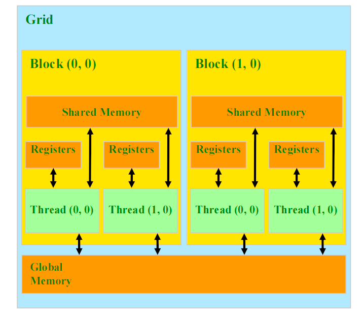
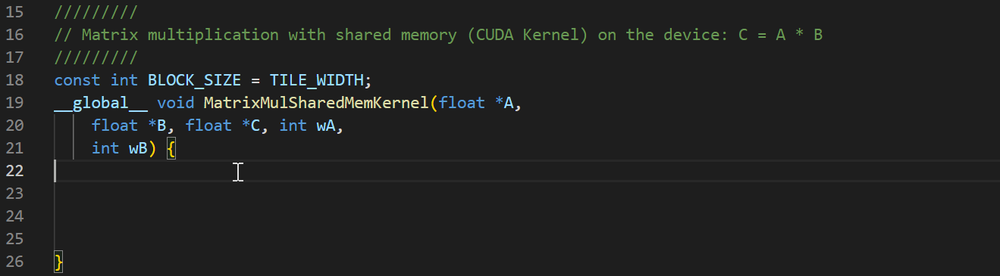
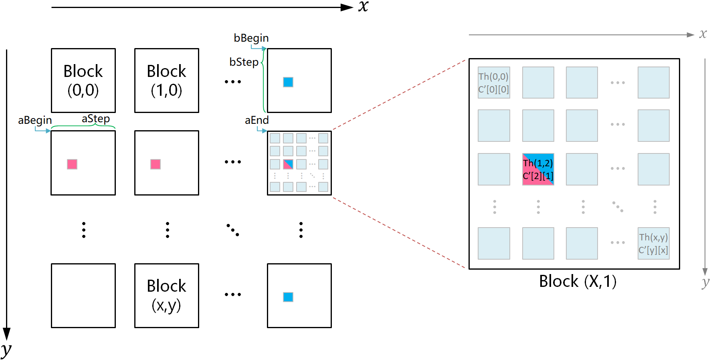
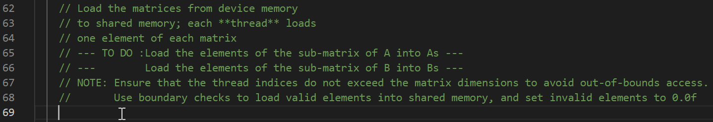
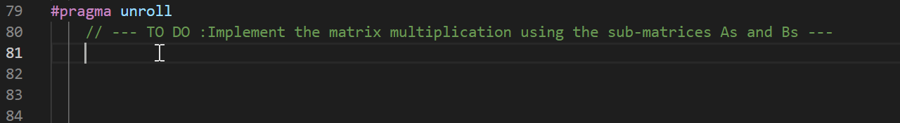
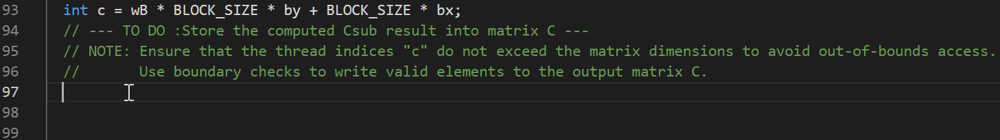
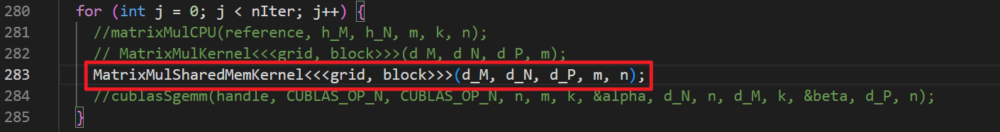
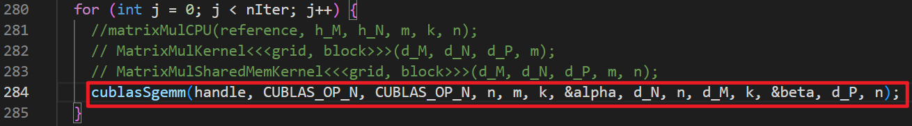

# 计算机体系结构实验 - 实验5指导书汇总

> 本文档为实验5所有章节的 1:1 完整汇总转译版，供离线阅读与后续 Agent 查阅。

## 目录导航

- [实验5：使用共享内存优化GPU代码](./00_实验概述.md)
- [实验原理](./01_实验原理.md)
- [实验步骤](./02_实验步骤.md)
- [实验报告要求](./03_实验报告要求.md)

---

<!-- Section: 00_实验概述.md -->
# 实验5：使用共享内存优化GPU代码

## 实验目的

  1. 掌握使用CUDA中的共享内存优化技巧提升矩阵乘法性能的方法；

  2. 掌握分析GPU程序性能瓶颈的方法；

  3. 掌握利用共享内存优化数据访问路径的方法。

## 实验前准备

  阅读以下资料，以了解如何在CUDA中使用共享内存优化矩阵乘法的基本原理。

- 《CUDA C Programming Guide》
- 《CUDA C++ Best Practices Guide》

  实验环境：一台安装了CUDA Toolkit、NVIDIA驱动程序和相关开发工具（如`nvcc`、`cuda-gdb`等）的计算机，操作系统为Ubuntu x64。

## 实验内容

  1. 使用CUDA的共享内存机制优化矩阵乘法算法，并对比优化前后的计算时间和效率；

  2. 调整`BLOCKSIZE`大小，对比不同`BLOCKSIZE`对运算效率的影响；

  3. 对比所实现的矩阵乘法与CUDA自带的矩阵乘法算子`cublasSgemm`之间的运行结果。


---

<!-- Section: 01_实验原理.md -->
# 实验原理

## CUDA共享显存优化

  共享内存（Shared Memory）是一种位于 CUDA 架构中每个流多处理器（Streaming Multiprocessor, SM）内的快速缓存，用于同一线程块内的线程共享数据。相比全局内存，访问共享内存的速度更快，因此在需要频繁访问相同数据时，共享内存能大幅提升性能。通过将多次使用的数据提前加载到共享内存，可有效减少全局内存的访问次数，从而降低延迟、提高带宽利用率。共享内存的加速原理可以概况为以下关键点：

- 快速访问速度：共享内存位于 CUDA 的每个流多处理器上，具有非常低的访问延迟，速度远快于全局显存。这使得它非常适合存储需要频繁访问的数据。
- 线程块内共享：共享内存可以被同一线程块内的所有线程访问和共享，这意味着多个线程可以协同工作，减少重复读取相同的数据，从而节省内存访问的时间。

  如图2-1所示，共享内存位于每个线程块内部，允许同一块内的所有线程快速共享数据，访问速度比全局内存快得多。减少了内存的访问次数，降低了延迟，并提高了内存带宽利用率。


图2-1 线程块结构和多层次内存关系的示意图


---

<!-- Section: 02_实验步骤.md -->
# 实验步骤

- **任务**：在实验四的代码基础上，利用GPU共享内存实现矩阵计算优化。
- **子任务**：

  - 对比相同矩阵规模下的计算时间和效率，验证共享内存的加速效果；
  - 调整不同`BLOCKSIZE`，对比不同`BLOCKSIZE`对运算效率的影响；
  - 利用CUDA自带的矩阵乘法算子`cublasSgemm`计算矩阵乘法，对比实验结果。
- **目标**：

  - 学会通过使用共享内存减少全局内存访问，提高数据访问效率；
  - 根据共享内存大小优化矩阵分块大小，提升计算性能。
- **实验代码**：`matrix_mul.cu`

#### 0. 复制以下代码，粘贴到实验四的`matrix_mul.cu`文件的第22行：

```
```c
  // Block index
  int bx = blockIdx.x;
  int by = blockIdx.y;

  // Thread index
  int tx = threadIdx.x;
  int ty = threadIdx.y;

  // Index of the first sub-matrix of A processed by the block
  int aBegin = wA * BLOCK_SIZE * by;

  // Index of the last sub-matrix of A processed by the block
  int aEnd   = aBegin + wA - 1;

  // Step size used to iterate through the sub-matrices of A
  int aStep  = BLOCK_SIZE;

  // Index of the first sub-matrix of B processed by the block
  int bBegin = BLOCK_SIZE * bx;

  // Step size used to iterate through the sub-matrices of B
  int bStep  = BLOCK_SIZE * wB;

  // Csub is used to store the element of the block sub-matrix
  // that is computed by the thread
  float Csub = 0;

  // Loop over all the sub-matrices of A and B
  // required to compute the block sub-matrix
  for (int a = aBegin, b = bBegin;
       a < aEnd;
       a += aStep, b += bStep) {
    // Declaration of the shared memory array As used to
    // store the sub-matrix of A
    __shared__ float As[BLOCK_SIZE][BLOCK_SIZE];

    // Declaration of the shared memory array Bs used to
    // store the sub-matrix of B
    __shared__ float Bs[BLOCK_SIZE][BLOCK_SIZE];

    // Load the matrices from device memory
    // to shared memory; each **thread** loads
    // one element of each matrix
    // --- TO DO :Load the elements of the sub-matrix of A into As ---
    // ---        Load the elements of the sub-matrix of B into Bs ---
    // NOTE: Ensure that the thread indices do not exceed the matrix dimensions to avoid out-of-bounds access.
    //       Use boundary checks to load valid elements into shared memory, and set invalid elements to 0.0f

    // Synchronize to make sure the matrices are loaded
    __syncthreads();

    // Multiply the two matrices together;
    // each thread computes one element
    // of the block sub-matrix
#pragma unroll
    // --- TO DO :Implement the matrix multiplication using the sub-matrices As and Bs ---

    // Synchronize to make sure that the preceding
    // computation is done before loading two new
    // sub-matrices of A and B in the next iteration
    __syncthreads();
  }

  // Write the block sub-matrix to device memory;
  // each thread writes one element
  int c = wB * BLOCK_SIZE * by + BLOCK_SIZE * bx;
  // --- TO DO :Store the computed Csub result into matrix C ---
  // NOTE: Ensure that the thread indices "c" do not exceed the matrix dimensions to avoid out-of-bounds access.
  //       Use boundary checks to write valid elements to the output matrix C.
```
```



  模板代码的实现思路如下图所示。代码中定义的线程数和矩阵  的元素个数相同，每个线程负责计算矩阵  的一个元素。每个线程块对应矩阵的一个分块，线程块中的每个线程则对应矩阵分块中的一个元素。



> [!NOTE] **符号说明**
>
> 上图右侧的`C'`表示矩阵  对应到图左侧第二行最后一列的线程块中的分块矩阵；`C'[2][1]`则表示该分块矩阵第3行第2列的元素，其他依此类推。

  计算时，每个线程只加载矩阵 、 对应到线程块中固定位置的一个元素。例如，上图右侧的线程`Thread(1,2)`在第一轮循环只加载图左侧`aBegin`指向的分块矩阵中的`A'[2][1]`和`bBegin`指向的分块矩阵中的`B'[2][1]`；在第二轮循环只加载`aBegin + aStep`指向的分块矩阵中的`A'[2][1]`和`bBegin + bStep`指向的分块矩阵中的`B'[2][1]`，依此类推。

  尽管线程`Thread(i,j)`每轮循环只加载`A'[j][i]`和`B'[j][i]`两个元素，**但在计算`C'[j][i]`时所需的`A'[j][k]`和`B'[k][i]`的所有元素（0 ≤ `k` < `BLOCK_SIZE`）都已经被线程块中的其他线程并行加载到了共享存储器中**，因此`Thread(i,j)`能够正确无误地完成`C'[j][i]`的计算。

  为方便实现，可将矩阵元素的索引分为 **线程块索引** 与 **块内线程索引** 两级索引。线程块索引是位于线程块左上角的线程的索引值，块内线程索引则是块内线程相对于线程块索引的偏移量。由上图可知，`C'[2][1]`由第`(X,1)`个线程块的第`(1,2)`个线程计算，结合矩阵  的列数`N`和线程块的边长`BLOCK_SIZE`，即可得到线程块`(X,1)`的二维索引是`[1*BLOCK_SIZE][X*BLOCK_SIZE]`，一维索引是`(1*N + X)*BLOCK_SIZE`；再由块内线程坐标`(1,2)`容易得出块内线程的二维索引是`[2][1]`，一维索引是`2*N + 1`。将两级索引值相加得出`C'[2][1]`对应到矩阵  的全局二维索引是`[1*BLOCK_SIZE + 2][X*BLOCK_SIZE + 1]`，一维索引是`(1*N + X)*BLOCK_SIZE + 2*N + 1`。

#### 1. 补全`MatrixMulSharedMemKernel`函数的共享内存优化矩阵乘法的代码。在第69行，实现每个线程分别加载矩阵A、B的一个元素到共享内存的`As[ty][tx]`、`Bs[ty][tx]`中，注意边界条件判断，避免访问越界导致计算结果有误



#### 2. 继续补全实验代码，计算线程负责的子矩阵元素`Csub`的累加值（第81行）。使用`for`循环遍历共享内存，计算矩阵`C`的一个元素的值 —— 将矩阵`As`和矩阵`Bs`的对应元素相乘并累加到`Csub`中



#### 3. 将结果写回矩阵`C`。在第97行，使用块索引 (`bx`, `by`) 和线程索引 (`tx`, `ty`) 计算矩阵`C`中的全局位置。写入全局内存之前，务必检查全局索引是否在矩阵`C`的有效范围内，以避免越界访问



#### 4. 修改`main`函数中的`for`循环，使其调用`MatrixMulSharedMemKernel`函数



#### 5. 保存文件，执行编译命令脚本，执行可执行文件`a.out`

```
bash compile.sh
./a.out 1 1000
```

#### 6. 查看并检查结果是否正确，对比使用全局内存的时间开销和计算效率（即与实验四的`MatrixMulKernel`函数进行对比）

  使用实验室电脑完成本实验时，若计算结果的大部分数值与参考值相差在 0.5 以内，可在上述步骤 3 的结果写回中自行添加四舍五入的逻辑。

#### 7. 更改块大小、矩阵大小（比如改为块大小的整数次幂），对比使用共享内存和全局内存的实验结果

#### 8. 打开第1行的`USE_CUBLAS`宏定义，修改`main`函数中的`for`循环，使其调用 CUDA 自带的矩阵乘法算子，编译运行并对比不同参数（块大小、矩阵大小）下的运行结果差异




`cublasSgemm`是 CUDA 的 [cuBLAS库](https://docs.nvidia.com/cuda/cublas/)的矩阵乘法函数，功能是计算 。该函数的使用方法详见 [docs.nvidia.com/cuda/cublas/index.html?#cublas-t-gemm](https://docs.nvidia.com/cuda/cublas/index.html?#cublas-t-gemm)。


---

<!-- Section: 03_实验报告要求.md -->
# 实验报告要求

  完成实验4 ~ 实验5，点击下载[实验报告模板](http://10.249.14.10:3011/2%20GPU%E4%BC%98%E5%8C%96%E4%B8%93%E9%A2%98%EF%BC%88%E5%AE%9E%E9%AA%8C4~5%EF%BC%89%E6%8A%A5%E5%91%8A%E6%A8%A1%E6%9D%BF.docx)，按以下要求撰写实验报告。

1. 实现流程（完整包含实验4~5的练习；结合关键代码/原理图以文字形式表述）；
2. 测试结果及原理分析（结合图表、文字等，对比分析输入矩阵尺寸和线程块大小对 CUDA 矩阵乘法计算结果的影响，对比分析共享内存优化前后、以及CUDA自带的矩阵乘法算子`cublasSgemm`的运行效果并描述相关原理）。

  将 **报告转成pdf格式**，提交前自行检查有无乱码、图片显示是否正常等。

  提交时，把以下内容压缩成.zip提交到作业系统。

```
- 学号-姓名.zip
    - 报告-学号-姓名.pdf        // 用模板撰写，转成pdf提交
    - src
        - matrix_mul_lab4.cu    // 实验4
        - matrix_mul_lab5.cu    // 实验5
```

  提交截止时间以作业系统为准。截止后有补交通道，但会扣迟交分。


---
