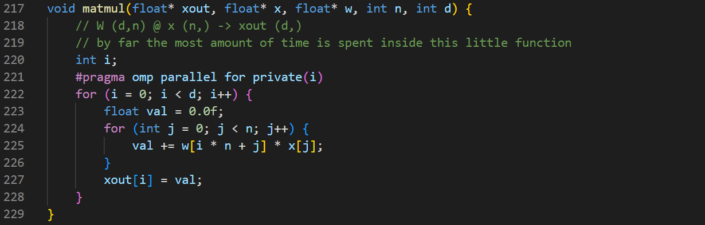
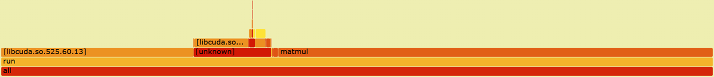
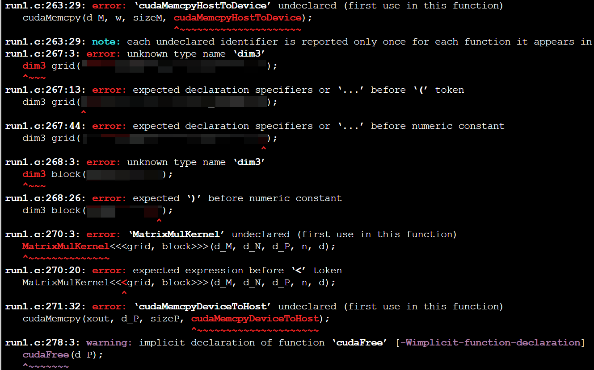
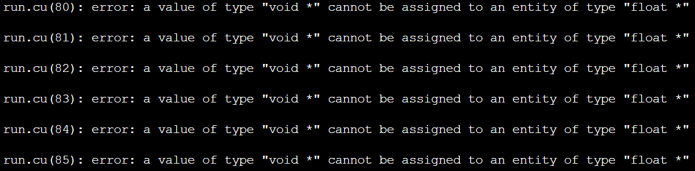
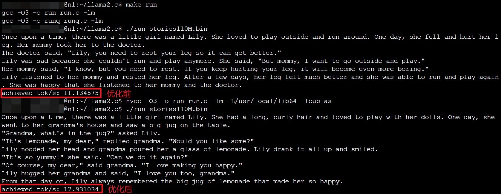

# 计算机体系结构实验 - 实验6指导书汇总

> 本文档为实验6所有章节的 1:1 完整汇总转译版，供离线阅读与后续 Agent 查阅。

## 目录导航

- [实验6：Llama模型推理性能评测](./00_实验概述.md)

---

<!-- Section: 00_实验概述.md -->
# 实验6：Llama模型推理性能评测

## 实验目的

  1. 学习综合运用所学的矩阵乘法优化手段，优化大模型推理性能；

  2. 理解计算机体系结构相关原理和技术在实际应用中的作用。

## 实验内容

[Llama2](https://github.com/karpathy/llama2.c) 是基于 Transformer 架构的轻量级开源自然语言处理模型，模型的推理和量化均使用单文件的 C 程序实现，且代码中含有丰富的注释，便于开发者进行移植、部署和优化。

  本实验是开放性实验，同学们可在前面实验涉及到的矩阵乘法优化方法中自由选择和组合，将优化后的矩阵乘法算法集成到 Llama2 大模型中，实现 Llama2 推理性能的加速。具体内容包括：

  1. 阅读 Llama2 推理程序的代码，了解其矩阵乘法的实现方式，并通过分析或调试得出其矩阵乘法运算的数据规模；

  2. 选用一种优化手段或将多种优化手段相结合，提升 Llama2 的矩阵乘法运算性能；

  3. 运行不同大小参数规模的 Llama2 模型，对比优化前后的推理性能并进行合理分析；

  4. 若优化后的推理速度与优化前相比有较为稳定的提升效果，可获得一定加分，加分值根据优化效果判定。

## 实验步骤

#### 0. 下载并解压实验包

  从 [Llama2官方仓库](https://github.com/karpathy/llama2.c) 或 [首页链接](../00_课程总览/00_课程概况.md)下载`llama2.c.tar.gz`和3个`.bin`文件。

  将`llama2.c.tar.gz`拷贝至用户目录，执行命令`tar -zxvf llama2.c.tar.gz`解压实验包。

  将3个`.bin`文件放置在解压后的`llama2.c/`目录下。

#### 1. 运行 Llama2 模型

  打开终端，`cd`到`llama2.c/`目录后，执行`make run`命令编译代码，随后执行`./run stories15M.bin`以运行 Llama2 模型。

  分别执行`./run stories42M.bin`和`./run stories110M.bin`，观察不同大小模型的运行时间差别。

#### 2. 查看矩阵乘法实现方式

  Llama2 的模型推理实现在 `run.c` 文件中，矩阵乘法函数则在其中的 [第217行](https://github.com/karpathy/llama2.c/blob/master/run.c#L217)。



  由注释可知，`matmul`函数实现的是  的矩阵  与维度为  的列向量  的乘法，且该函数是模型推理的性能瓶颈（感兴趣的同学们可使用`perf`工具验证）。

> [!NOTE] **使用perf分析推理程序的性能瓶颈**
>
> `perf`工具支持通过`record`命令收集程序的运行时数据，并通过`script`命令生成性能分析图表。
>
> `record`命令的使用方法如下：
>
> ```
> perf record -F <samples_per_sec> -g -- <some_program> <args>
> ```
>
>   其中，`<some_program>`是待收集数据的程序，`<args>`是程序运行所需的命令行参数，而`<samples_per_sec>`则设定每秒的采样次数。
>
>   在终端执行命令`perf record -F 100 -g -- ./run storiesXXX.bin`，`perf`工具将自动采集LLAMA2推理程序的相关性能数据。等待命令运行完毕后，依次执行下列命令生成火焰图：
>
> ```
> perf script -i perf.data > perf.unfold
> /usr/bin/flamegraph/stackcollapse-perf.pl perf.unfold > perf.folded
> /usr/bin/flamegraph/flamegraph.pl perf.folded > perf.svg
> ```
>
>   在浏览器打开`perf.svg`查看火焰图，如下图所示。火焰图的纵坐标表示函数的调用栈。函数被连续调用的次数越多，栈越深，火焰也就越高。横坐标表示程序在运行过程中被`perf`工具捕获的次数。被捕获次数越多，表示函数的执行耗时越长。
>
> 

#### 3. 通过调试手段查看矩阵乘法的数据规模大小

  通过在代码中添加`printf`语句，或使用 GDB 等调试工具，查看`matmul`函数的输入矩阵的尺寸参数。

#### 4. 自行选择恰当的优化方法优化`matmul`函数

  根据上一步测得的数据规模大小，选择合适的优化方法，然后修改前面实验实现的矩阵优化算法，并将其集成到`run.c`中。

  修改代码后，应先编译代码再执行`./run xxx.bin`，编译时根据需要链接相应的库，具体可参考前面实验的代码。若使用 CUDA 优化，需执行`nvcc -arch=compute_35 -O3 -std=c++17 -o run run.c -lm`命令编译代码；若使用了 cuBLAS 库，则执行`nvcc -arch=compute_35 -O3 -std=c++17 -o run run.c -lm -L/usr/local/lib64 -lcublas`编译代码；若采用 AVX、OpenMP 等其他优化方法，则直接执行`make run`即可。

> [!TIP] **关于使用 CUDA 编译时可能出现的问题**
>
> 若确认代码无语法错误，但执行`nvcc -arch=compute_35 -O3 -std=c++17 -o run run.c -lm`命令进行编译时，提示`dim3`、`<<<`等 CUDA 特有的语法和语句存在错误，如下图所示。
>
> 
>
>   此时，执行`cp run.c run.cu`给源文件创建后缀为`.cu`的副本，再次尝试编译。编译时可能出现如下图所示的错误提示。
>
> 
>
>   根据报错信息，找到对应语句，添加强制类型转换。比如将`run.cu`第80行的语句改成：
>
> ```
>     s->x = (float*)calloc(p->dim, sizeof(float));
> ```
>
>   修改后保存文件，再次编译即可。

#### 5. 对比分析优化前后的推理性能

  分别使用3个不同参数规模的`.bin`文件对优化前后的 Llama2 模型各自运行3~5次，记录推理速度平均值，与优化前的运行效果进行对比，尝试对结果进行分析和优化。

  下图是使用 CUDA 优化的示例，仅作为优化前后程序运行效果对比的参考。实际加速效果取决于所实现的算法和计算机的硬件配置。



## 实验报告要求

  点击下载[实验报告模板](../templates/3 Llama测试（实验6）报告模板.docx)，按以下要求撰写实验报告。

1. 实现流程（结合关键代码/原理图以文字形式表述）；
2. 测试结果及原理分析（结合图表、文字等，对比分析优化前后的运行效果并描述所采用优化措施的原理）。

  将 **报告转成pdf格式**，提交前自行检查有无乱码、图片显示是否正常等。

  提交时，把以下内容压缩成.zip提交到作业系统。

```
- 学号-姓名.zip
    - 报告-学号-姓名.pdf        // 用模板撰写，转成pdf提交
    - src                     // 存放修改过的代码文件
```

  提交截止时间以作业系统为准。截止后有补交通道，但会扣迟交分。


---
